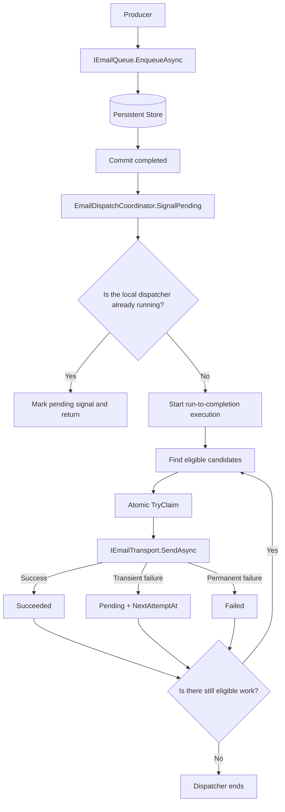
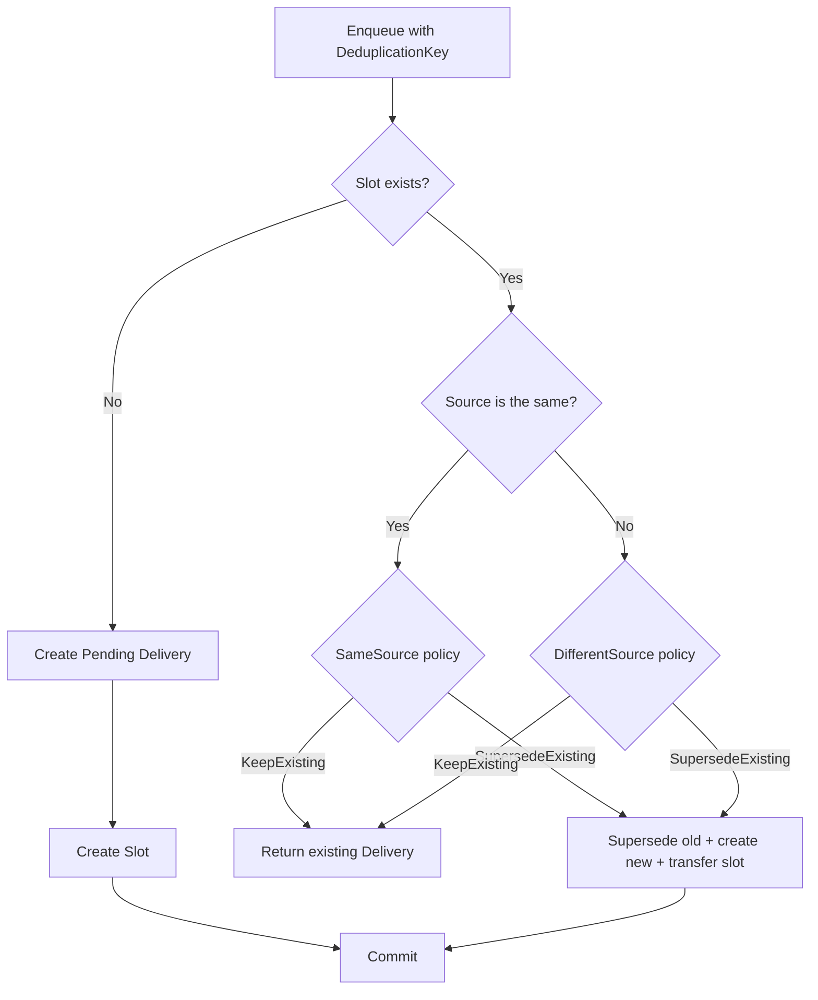
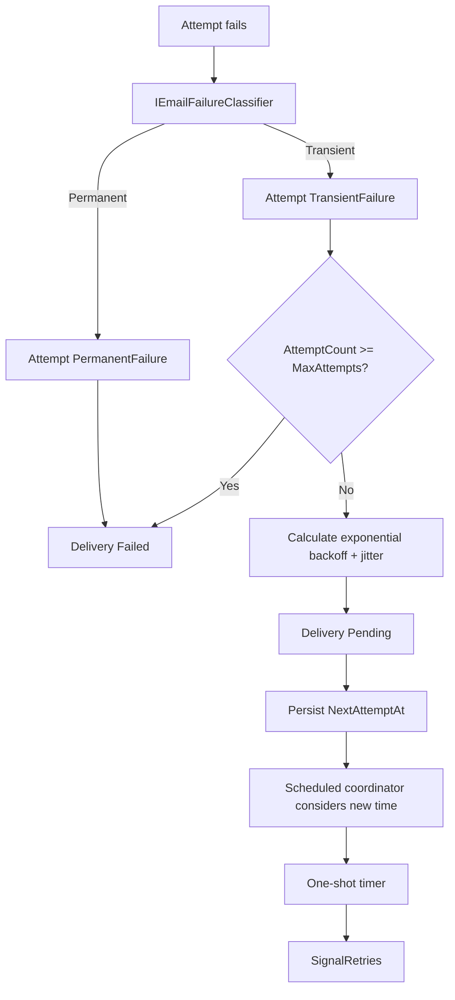
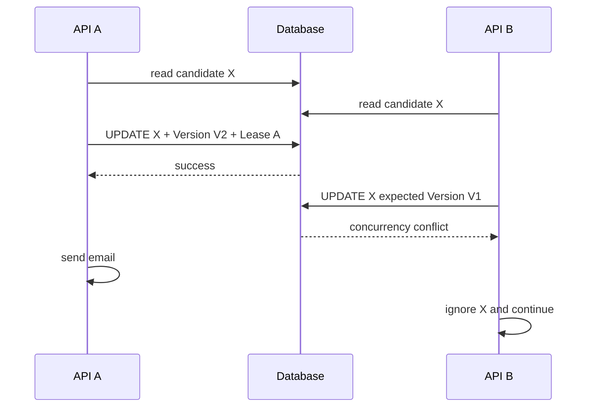
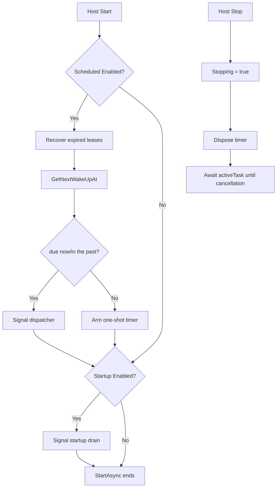

# JadByte.DurableMail — Implementation Plan v0.1

> **Status:** architecture finalized for implementation to begin.
>
> **Primary target:** .NET 10.
>
> **Planned Package IDs:**
>
> - `JadByte.DurableMail`
> - `JadByte.DurableMail.EntityFrameworkCore`
> - `JadByte.DurableMail.AspNetCore`
> - `JadByte.DurableMail.MailKit`

---

## 1. Objective

`JadByte.DurableMail` will be a lightweight library for **durable email delivery outside the HTTP request**, with persistence, traceable attempts, retry with exponential backoff, deduplication/supersession and concurrency safety.

The library **will not be a generic scheduler**, **will not be a message broker** and **will not be a replacement for Hangfire/Quartz**.

Its scope is deliberately specific:

```text
Email
Delivery
Persistence
Attempts
Retry
Dispatch
Deduplication
Supersession
Concurrency
Transport
```

It must not know about:

```text
ASP.NET Core Identity
/register
/resendConfirmationEmail
CloudFolderVault
MariaDB
MySQL
PostgreSQL
SQL Server
Oracle
any consumer business domain
```

The consumer integrates the library with their domain/framework however they choose.

---

## 2. Non-negotiable architectural decisions for v0.1

1. **Do not use `BackgroundService`.**
2. **Do not maintain a permanent loop.**
3. **Do not periodically poll the database.**
4. **Do not keep a worker continuously consuming CPU.**
5. Processing will be **run-to-completion**: it starts when signaled, drains eligible work and ends.
6. Scheduled retry will use a **one-shot timer**, never a periodic timer.
7. Persistence will be abstract in the Core.
8. The official persistence implementation will be based on **EF Core**, without a concrete provider.
9. The consumer chooses their EF Core provider.
10. The library will not distribute universal database migrations.
11. Real concurrency guarantees will come from persistence, not `IMemoryCache`, middleware or a timer.
12. `IMemoryCache` will not be used as a correctness mechanism.
13. Delivery will have **at-least-once** semantics.
14. The library does not promise exactly-once for SMTP or any external transport.
15. The Core does not reference EF Core, ASP.NET Core or MailKit.
16. `JadByte.DurableMail.EntityFrameworkCore` does not reference a specific database provider.
17. `JadByte.DurableMail.AspNetCore` contains only HTTP/ASP.NET Core integration.
18. `JadByte.DurableMail.MailKit` contains only SMTP transport and MailKit-specific failure classification.
19. Endpoint rate limiting does not belong in the library.
20. ASP.NET Core Identity integration does not belong in the library.

---

## 3. Main flow



The request waits only for the job to be persisted. It **does not wait for DNS, TCP connection, TLS, SMTP authentication, sending or the SMTP server response**.

---

## 4. Retry triggers

All triggers call the **same dispatcher**. No trigger implements retry on its own.

The library must allow freely combining:

```csharp
options.Retries.Scheduled.Enabled = true;
options.Retries.Enqueue.Enabled = false;
options.Retries.Middleware.Enabled = false;
options.Retries.Startup.Enabled = false;
```

Official defaults:

```text
Scheduled.Enabled       = true
Enqueue.Enabled         = false
Middleware.Enabled      = false
Middleware.Interval     = 1 minute
Startup.Enabled         = false
Manual                  = always available
```

### 4.1 Scheduled — enabled by default

This is the main retry mechanism.

When `NextAttemptAt` exists, the library schedules **a single one-shot timer** for the next known time.

```text
failure
↓
NextAttemptAt persisted
↓
one-shot timer armed
↓
no continuous processing
↓
timer fires
↓
SignalRetries()
↓
dispatcher processes
↓
arm the next timer, if any
↓
end
```

Implement with `TimeProvider.CreateTimer(...)` and `period: Timeout.InfiniteTimeSpan`.

Do not create a periodic timer.

The local scheduler must keep at most one active `ITimer`.

### 4.2 Enqueue — disabled by default

`Dispatch.AutoDispatchOnEnqueue = true` is separate from this option.

By default, every new job already signals **its own** processing.

When:

```csharp
options.Retries.Enqueue.Enabled = true;
```

each enqueue also provides an opportunity to look for retries that are already due.

Therefore:

```text
new job
↓
normal processing of the new job
+
scan for due retries
```

Do not confuse `Dispatch.AutoDispatchOnEnqueue` with `Retries.Enqueue.Enabled`.

### 4.3 Middleware — disabled by default

Required configuration:

```csharp
options.Retries.Middleware.Enabled = true;
options.Retries.Middleware.Interval = TimeSpan.FromMinutes(1);
```

`Interval` defaults to **1 minute**.

The middleware does not access the database directly.

Flow:

```text
HTTP request
↓
MiddlewareRetryGate
↓
has the minimum interval not yet elapsed?
├─ Yes → next(context)
└─ No → SignalRetries() → next(context)
```

The gate must be local to the instance and used only as a **signaling throttle**.

Do not use `IMemoryCache` for this. Prefer `TimeProvider.GetTimestamp()` + `Interlocked`, because the monotonic timestamp is not affected by wall-clock adjustments.

Distributed protection remains in the database through claim/lease/concurrency token.

### 4.4 Startup — disabled by default

When enabled, performs a single recovery/drain run during initialization.

Useful when the application has been offline and the consumer wants an explicit scan of pending work immediately at startup.

It does not start a loop and does not remain running.

### 4.5 Manual — always available

Provide:

```csharp
public interface IEmailRetryDispatcher
{
    Task<EmailDispatchResult> DispatchDueAsync(
        CancellationToken cancellationToken = default);
}
```

It can be used by a CLI, administrative endpoint, external cron, Kubernetes CronJob, test or maintenance tool.

---

## 5. Recovery after restart

There is an important difference between the optional `Startup` trigger and the minimum restoration required by `Scheduled`.

When `Retries.Scheduled.Enabled == true`, the lifecycle service must, at startup:

1. check for expired leases;
2. discover the next eligible work;
3. if it is already due, signal processing;
4. if it is in the future, rearm the one-shot timer.

This is **rehydration of the persisted schedule**, not the optional `Startup` trigger.

Without this step, a job persisted before a crash could be forgotten after restart.

If the consumer explicitly disables all automatic triggers, they accept that old jobs depend on `Manual`, a new `Enqueue` or another trigger they configure.

---

## 6. Solution structure

```text
JadByte.DurableMail/
├── JadByte.DurableMail.slnx
├── Directory.Build.props
├── Directory.Packages.props
├── global.json
├── README.md
├── CHANGELOG.md
├── LICENSE                     # only after the author chooses the license
├── src/
│   ├── JadByte.DurableMail/
│   │   └── JadByte.DurableMail.csproj
│   ├── JadByte.DurableMail.EntityFrameworkCore/
│   │   └── JadByte.DurableMail.EntityFrameworkCore.csproj
│   ├── JadByte.DurableMail.AspNetCore/
│   │   └── JadByte.DurableMail.AspNetCore.csproj
│   └── JadByte.DurableMail.MailKit/
│       └── JadByte.DurableMail.MailKit.csproj
├── tests/
│   ├── JadByte.DurableMail.Tests/
│   ├── JadByte.DurableMail.EntityFrameworkCore.Tests/
│   ├── JadByte.DurableMail.AspNetCore.Tests/
│   └── JadByte.DurableMail.MailKit.Tests/
└── samples/
    └── JadByte.DurableMail.Sample.MinimalApi/
```

Do not create an `All` aggregate package in v0.1.

---

## 7. Initial project creation

At the repository root:

```bat
dotnet new sln -n JadByte.DurableMail

dotnet new classlib -n JadByte.DurableMail -f net10.0 -o src/JadByte.DurableMail
dotnet new classlib -n JadByte.DurableMail.EntityFrameworkCore -f net10.0 -o src/JadByte.DurableMail.EntityFrameworkCore
dotnet new classlib -n JadByte.DurableMail.AspNetCore -f net10.0 -o src/JadByte.DurableMail.AspNetCore
dotnet new classlib -n JadByte.DurableMail.MailKit -f net10.0 -o src/JadByte.DurableMail.MailKit

dotnet new xunit -n JadByte.DurableMail.Tests -f net10.0 -o tests/JadByte.DurableMail.Tests
dotnet new xunit -n JadByte.DurableMail.EntityFrameworkCore.Tests -f net10.0 -o tests/JadByte.DurableMail.EntityFrameworkCore.Tests
dotnet new xunit -n JadByte.DurableMail.AspNetCore.Tests -f net10.0 -o tests/JadByte.DurableMail.AspNetCore.Tests
dotnet new xunit -n JadByte.DurableMail.MailKit.Tests -f net10.0 -o tests/JadByte.DurableMail.MailKit.Tests

dotnet new webapi -n JadByte.DurableMail.Sample.MinimalApi -f net10.0 -o samples/JadByte.DurableMail.Sample.MinimalApi
```

Add everything to the solution.

---

## 8. Project references

Production:

```text
JadByte.DurableMail.EntityFrameworkCore
    → JadByte.DurableMail

JadByte.DurableMail.AspNetCore
    → JadByte.DurableMail

JadByte.DurableMail.MailKit
    → JadByte.DurableMail
```

Core does not reference any adapter.

Tests:

```text
JadByte.DurableMail.Tests
    → JadByte.DurableMail

JadByte.DurableMail.EntityFrameworkCore.Tests
    → JadByte.DurableMail.EntityFrameworkCore

JadByte.DurableMail.AspNetCore.Tests
    → JadByte.DurableMail.AspNetCore

JadByte.DurableMail.MailKit.Tests
    → JadByte.DurableMail.MailKit
```

The sample references all four projects during development.

---

## 9. Central Package Management

Use `Directory.Packages.props` to avoid divergent versions across projects.

Versions verified on 27/09/2026:

```xml
<Project>
  <PropertyGroup>
    <ManagePackageVersionsCentrally>true</ManagePackageVersionsCentrally>
  </PropertyGroup>

  <ItemGroup>
    <PackageVersion Include="Microsoft.Extensions.DependencyInjection.Abstractions" Version="10.0.12" />
    <PackageVersion Include="Microsoft.Extensions.Logging.Abstractions" Version="10.0.12" />
    <PackageVersion Include="Microsoft.Extensions.Options" Version="10.0.12" />
    <PackageVersion Include="Microsoft.Extensions.Options.ConfigurationExtensions" Version="10.0.12" />
    <PackageVersion Include="Microsoft.Extensions.Hosting.Abstractions" Version="10.0.12" />
    <PackageVersion Include="Microsoft.EntityFrameworkCore" Version="10.0.12" />
    <PackageVersion Include="Microsoft.EntityFrameworkCore.Sqlite" Version="10.0.12" />
    <PackageVersion Include="MailKit" Version="4.18.0" />
    <PackageVersion Include="Microsoft.Extensions.TimeProvider.Testing" Version="10.9.0" />
    <PackageVersion Include="Microsoft.NET.Test.Sdk" Version="18.10.1" />
    <PackageVersion Include="xunit.v3" Version="4.0.1" />
  </ItemGroup>
</Project>
```

Before publishing a future version, review versions again; do not treat this table as a permanent update policy.

---

## 10. Dependencies by project

### `JadByte.DurableMail`

Allowed dependencies:

```text
Microsoft.Extensions.DependencyInjection.Abstractions
Microsoft.Extensions.Logging.Abstractions
Microsoft.Extensions.Options
Microsoft.Extensions.Options.ConfigurationExtensions
Microsoft.Extensions.Hosting.Abstractions
```

Do not add EF Core, MailKit or ASP.NET Core.

### `JadByte.DurableMail.EntityFrameworkCore`

```text
Microsoft.EntityFrameworkCore
JadByte.DurableMail
```

Do not add `SqlServer`, `Npgsql`, `Pomelo`, Oracle or SQLite as a production dependency.

### `JadByte.DurableMail.AspNetCore`

Reference Core and add to the `.csproj`:

```xml
<ItemGroup>
  <FrameworkReference Include="Microsoft.AspNetCore.App" />
</ItemGroup>
```

Do **not** install `Microsoft.AspNetCore.App` as a PackageReference.

### `JadByte.DurableMail.MailKit`

```text
MailKit
JadByte.DurableMail
```

---

## 11. `Directory.Build.props`

Centralize technical defaults:

```xml
<Project>
  <PropertyGroup>
    <TargetFramework>net10.0</TargetFramework>
    <Nullable>enable</Nullable>
    <ImplicitUsings>enable</ImplicitUsings>
    <TreatWarningsAsErrors>true</TreatWarningsAsErrors>
    <GenerateDocumentationFile>true</GenerateDocumentationFile>
    <Deterministic>true</Deterministic>
    <AnalysisLevel>latest-recommended</AnalysisLevel>
  </PropertyGroup>
</Project>
```

Do not choose a license on behalf of the author. MIT is recommended for a library of this type, but this is a separate legal/product decision.

---

## 12. Package IDs, namespaces and assemblies

Use exactly:

```text
PackageId:     JadByte.DurableMail
AssemblyName:  JadByte.DurableMail
RootNamespace: JadByte.DurableMail

PackageId:     JadByte.DurableMail.EntityFrameworkCore
AssemblyName:  JadByte.DurableMail.EntityFrameworkCore
RootNamespace: JadByte.DurableMail.EntityFrameworkCore

PackageId:     JadByte.DurableMail.AspNetCore
AssemblyName:  JadByte.DurableMail.AspNetCore
RootNamespace: JadByte.DurableMail.AspNetCore

PackageId:     JadByte.DurableMail.MailKit
AssemblyName:  JadByte.DurableMail.MailKit
RootNamespace: JadByte.DurableMail.MailKit
```

Do not invent different abbreviations across package, assembly and namespace.

The exact name must be validated on NuGet again immediately before the first publication. The current review found no indexed result for the exact ID `JadByte.DurableMail`, but this does not reserve the name.

---

## 13. Minimal public Core API

Initially, expose only what is necessary:

```text
IEmailQueue
IEmailTransport
IEmailFailureClassifier
IEmailRetryDispatcher
IEmailDeliveryMaintenance      # manual maintenance; no automatic worker

EmailMessage
EmailEnqueueRequest
EmailEnqueuePolicy
EmailEnqueueResult
EmailEnqueueOutcome
ActiveDeliveryConflictBehavior
EmailBodyFormat
EmailFailureKind
EmailDispatchResult
DurableMailOptions
IDurableMailBuilder
```

Storage contracts needed by external adapters may be public in an advanced namespace:

```text
JadByte.DurableMail.Storage
```

Everything else must start as `internal`.

A public API is a future compatibility commitment; avoid exposing internals prematurely.

---

## 14. Public message

```csharp
public enum EmailBodyFormat
{
    Html = 0,
    PlainText = 1
}

public sealed record EmailMessage(
    string Recipient,
    string Subject,
    string Body,
    EmailBodyFormat BodyFormat = EmailBodyFormat.Html);
```

Validate in the Core:

- `Recipient` is not empty;
- `Subject` is not null;
- `Body` is not null.

Do not impose an SMTP parser on the Core. Address-specific validation belongs in the transport adapter.

Attachments are outside v0.1.

---

## 15. Enqueue request

```csharp
public sealed record EmailEnqueueRequest(
    EmailMessage Message,
    string? Source = null,
    string? DeduplicationKey = null,
    EmailEnqueuePolicy? Policy = null);
```

`Source` is semantic metadata provided by the consumer.

Possible examples — documentation only, never hardcoded in the Core:

```text
identity:registration
identity:resend-confirmation
billing:invoice
notifications:security-alert
```

`DeduplicationKey` represents an active logical delivery.

---

## 16. Conflict/deduplication policy

Do not offer `Allow` when `DeduplicationKey` exists.

If the consumer wants to allow duplicates, they should simply omit the key.

```csharp
public enum ActiveDeliveryConflictBehavior
{
    KeepExisting = 0,
    SupersedeExisting = 1
}
```

```csharp
public sealed class EmailEnqueuePolicy
{
    public ActiveDeliveryConflictBehavior SameSource { get; init; }
        = ActiveDeliveryConflictBehavior.KeepExisting;

    public ActiveDeliveryConflictBehavior DifferentSource { get; init; }
        = ActiveDeliveryConflictBehavior.KeepExisting;
}
```

This avoids contradictory semantics in which a unique slot would have to represent multiple active jobs.

---

## 17. Enqueue result

```csharp
public enum EmailEnqueueOutcome
{
    Created = 0,
    Existing = 1,
    SupersededAndCreated = 2
}

public sealed record EmailEnqueueResult(
    Guid DeliveryId,
    EmailEnqueueOutcome Outcome);
```

---

## 18. `IEmailQueue`

```csharp
public interface IEmailQueue
{
    Task<EmailEnqueueResult> EnqueueAsync(
        EmailEnqueueRequest request,
        CancellationToken cancellationToken = default);
}
```

`EnqueueAsync` must:

1. validate the request;
2. persist the job durably;
3. apply deduplication/supersession transactionally;
4. confirm the commit;
5. signal processing only after the commit;
6. return without waiting for the external transport.

Never signal before the commit.

---

## 19. The library's unit of work

v0.1 must treat enqueue as **its own unit of work**.

Do not silently reuse the consumer's request `DbContext`, and do not call `SaveChangesAsync` on a context that may contain business changes unrelated to the library.

The implementation must create its own scope for the persistence operation.

Documented consequence:

> v0.1 does not offer automatic transactional atomicity between the consumer's business changes and a DurableMail enqueue.

A future Outbox/UoW integration can be added separately without complicating the first release.

---

## 20. Persistent states

Persist explicitly:

```csharp
internal enum EmailDeliveryStatus
{
    Pending = 0,
    Processing = 1,
    Succeeded = 2,
    Failed = 3,
    Superseded = 4
}
```

Do not create `Retrying`.

A waiting retry is simply:

```text
Status = Pending
AttemptCount > 0
NextAttemptAt != null
```

`Canceled` is outside v0.1 because `Superseded` already covers the agreed case of abandoning a delivery in favor of a newer one. Add manual cancellation only when there is a real requirement.

---

## 21. Attempt outcomes

```csharp
internal enum EmailAttemptOutcome
{
    Succeeded = 0,
    TransientFailure = 1,
    PermanentFailure = 2,
    Abandoned = 3
}
```

`Abandoned` represents an execution that started but whose outcome is no longer known — for example, a process terminated after a claim.

---

## 22. Persistent EF model — internal to the adapter

EF entities must be `internal` in `JadByte.DurableMail.EntityFrameworkCore`.

The Core does not need to expose database entities.

Create:

```text
Persistence/Entities/
├── EmailDeliveryEntity.cs
├── EmailDeliveryAttemptEntity.cs
└── EmailDeliverySlotEntity.cs
```

### `EmailDeliveryEntity`

Minimum fields:

```text
Id                          Guid
Recipient                   string
Subject                     string
Body                        string
BodyFormat                  int
Status                      int
Source                      string?
DeduplicationKey            string?
AttemptCount                int
MaxAttempts                 int
CreatedAt                   DateTimeOffset
UpdatedAt                   DateTimeOffset
LastAttemptAt               DateTimeOffset?
NextAttemptAt               DateTimeOffset?
CompletedAt                 DateTimeOffset?
FailedAt                    DateTimeOffset?
SupersededAt                DateTimeOffset?
SupersededByDeliveryId      Guid?
LeaseId                     Guid?
LeaseExpiresAt              DateTimeOffset?
Version                     Guid
```

### `EmailDeliveryAttemptEntity`

```text
Id                          Guid
EmailDeliveryId             Guid
AttemptNumber               int
StartedAt                   DateTimeOffset
FinishedAt                  DateTimeOffset?
Outcome                     int?
ErrorType                   string?
ErrorMessage                string?
StackTrace                  string?
```

### `EmailDeliverySlotEntity`

```text
Key                         string PK
DeliveryId                  Guid
Source                      string?
Version                     Guid
```

---

## 23. Tables and columns

Fixed, predictable names:

```text
durable_mail_deliveries
durable_mail_attempts
durable_mail_slots
```

Map all columns explicitly in `snake_case`, regardless of the consumer's naming convention.

This prevents the library's schema from changing based on external naming plugins.

Recommended limits:

```text
Source                  128
DeduplicationKey        256
ErrorType               512
ErrorMessage            4096
StackTrace              16384
```

Do not index `Body`, `Subject`, `ErrorMessage` or `StackTrace`.

---

## 24. Minimum indexes

Create only indexes justified by the queries:

```text
(status, next_attempt_at)
(status, created_at)
(status, lease_expires_at)
(email_delivery_id, attempt_number) UNIQUE
slots.key PRIMARY KEY
```

An index on `deliveries.deduplication_key` may exist for diagnostics, but it does not replace `slots` as the active uniqueness mechanism.

---

## 25. Provider-agnostic optimistic concurrency

Do not depend on:

```text
SQL Server rowversion
PostgreSQL xmin
SELECT FOR UPDATE
GET_LOCK
sp_getapplock
provider-specific SQL
```

Use `Guid Version` as an application-managed concurrency token.

EF mapping:

```csharp
builder.Property(x => x.Version)
    .IsConcurrencyToken();
```

Before each relevant concurrent transition:

```csharp
entity.Version = Guid.NewGuid();
```

If another process modified the row first:

```text
DbUpdateConcurrencyException
```

The caller interprets this as a lost claim/expected conflict, not a fatal failure.

---

## 26. Claim + lease

Never do:

```text
SELECT Pending
↓
SEND
```

Required flow:

```text
Pending
↓
TryClaim
↓
Processing
↓
LeaseId
LeaseExpiresAt
AttemptCount++
INSERT Attempt
↓
COMMIT
↓
Send
```

Claim and attempt creation must occur within the same transactional unit.

Return an internal execution token, for example:

```csharp
internal sealed record ClaimedEmailDelivery(
    Guid DeliveryId,
    Guid AttemptId,
    Guid LeaseId,
    Guid Version,
    int AttemptNumber,
    EmailMessage Message);
```

The `MarkSucceeded`, `MarkTransientFailure` and `MarkPermanentFailure` operations must validate `LeaseId`/`Version` to prevent an old worker from overwriting state after losing the lease.

---

## 27. Lease duration

Default:

```csharp
options.Dispatch.LeaseDuration = TimeSpan.FromMinutes(2);
```

The default must be comfortably longer than the MailKit transport's default timeout.

Do not implement a heartbeat/periodic lease renewal in v0.1.

Consequence: if the consumer configures a transport that can take longer than `LeaseDuration`, they must increase the lease.

The dispatcher must claim only immediately before executing the delivery. Do not claim dozens of jobs and leave them waiting in a local queue while the lease expires.

---

## 28. Expired lease recovery

Before draining eligible work, recover expired leases.

For each:

```text
Status = Processing
LeaseExpiresAt <= now
```

1. find the attempt without `FinishedAt`;
2. mark it `Abandoned`;
3. set `FinishedAt = now`;
4. clear the lease;
5. consider this attempt consumed;
6. if `AttemptCount >= MaxAttempts`, mark `Failed`;
7. otherwise, return to `Pending` and calculate a new `NextAttemptAt` using the retry policy.

Do not assume that no email was sent. The attempt becomes `Abandoned` precisely because the external outcome is unknown.

---

## 29. At-least-once semantics

An unavoidable example:

```text
SMTP accepts the message
↓
connection drops before the application receives confirmation
↓
application classifies it as a failure
↓
retry
↓
user may receive two messages
```

The library must consider the delivery **unconfirmed** and allow retry.

Objective:

```text
avoid silent loss                    ✅
avoid duplicates caused by the queue ✅
exactly-once in an external system   ❌
```

Document this clearly in the README.

---

## 30. Deduplication through a slot

Do not use only:

```text
SELECT exists?
↓
INSERT
```

Two concurrent requests could pass the SELECT.

`durable_mail_slots.key` is a PK and represents ownership of an active logical delivery.

Transactional flow:

```text
BEGIN
↓
look for slot
↓
if it does not exist:
    create delivery
    create slot pointing to delivery
↓
if it exists:
    apply SameSource/DifferentSource policy
↓
COMMIT
```

If two transactions try to create the same slot:

```text
A does not find it
B does not find it
A INSERT wins
B INSERT fails
```

Do not interpret provider-specific codes.

Upon receiving `DbUpdateException` in this race:

1. roll back;
2. open a new operation;
3. query the slot;
4. if the slot now exists, treat it as a legitimate race;
5. if it still does not exist, rethrow the original exception.

---

## 31. Supersession

Generic example:

```text
Logical Key = account-confirmation:user-123
Source A = registration
Source B = resend-confirmation
```

Configuration:

```text
SameSource      = KeepExisting
DifferentSource = SupersedeExisting
```

Flow:

```text
Job A / registration / Pending
↓
resend-confirmation arrives
↓
Job A → Superseded
Job B → Pending
slot → Job B
```

Another resend while Job B is active:

```text
same source
↓
KeepExisting
↓
return Job B
```

### Superseding `Pending`

Mark immediately:

```text
Status = Superseded
SupersededAt = now
SupersededByDeliveryId = newId
```

No additional retries.

### Superseding `Processing`

Do not pretend that the transport was canceled.

Record the intent to supersede, but let the current attempt finish.

If the current attempt:

- **succeeds:** the actual final state must be `Succeeded`;
- **fails:** do not schedule a retry, and finalize as `Superseded`.

This preserves observable reality.

---

## 32. Releasing the slot

Release or transfer the slot when a delivery reaches a terminal state:

```text
Succeeded  → remove slot if still the owner
Failed     → remove slot if still the owner
Superseded → slot must already point to the replacement or be removed
```

Never remove a slot based solely on `DeduplicationKey`; validate that `DeliveryId` still matches the expected owner.

---

## 33. Retry options

Public configuration:

```csharp
options.Retries.MaxAttempts = 5;
options.Retries.InitialDelay = TimeSpan.FromMinutes(2);
options.Retries.BackoffFactor = 2;
options.Retries.MaxDelay = TimeSpan.FromMinutes(30);
options.Retries.JitterRatio = 0.15;
```

`MaxAttempts` represents **total attempts**, not “additional retries”.

Therefore:

```text
MaxAttempts = 5
```

means at most five calls to the transport.

---

## 34. Exponential backoff

Create an internal or extensible abstraction:

```csharp
public interface IRetryDelayCalculator
{
    TimeSpan Calculate(
        int failedAttemptCount,
        EmailRetryOptions options);
}
```

Default:

```text
baseDelay = InitialDelay * BackoffFactor^(failedAttemptCount - 1)
baseDelay = min(baseDelay, MaxDelay)

jitterWindow = baseDelay * JitterRatio
finalDelay = baseDelay + random(-jitterWindow, +jitterWindow)
```

Clamp the final value to >= zero.

With defaults:

```text
failure 1 → ~2 min
failure 2 → ~4 min
failure 3 → ~8 min
failure 4 → ~16 min
```

Do not call a linear progression exponential backoff.

---

## 35. `TimeProvider`

Never scatter direct uses of `DateTimeOffset.UtcNow` throughout the code.

Register the default:

```csharp
TimeProvider.System
```

with `TryAddSingleton`, allowing it to be replaced.

Use:

```csharp
timeProvider.GetUtcNow()
```

for persisted timestamps.

Use `GetTimestamp()`/`GetElapsedTime()` for local interval throttling, such as in middleware.

Use `CreateTimer()` for the one-shot timer.

This makes retries, leases, middleware, and scheduling deterministically testable.

---

## 36. Scheduled coordinator

Create:

```text
Retries/
├── RetryScheduleCoordinator.cs
├── ExponentialRetryDelayCalculator.cs
└── RetryTriggerReason.cs
```

`RetryScheduleCoordinator` must be a singleton and own at most one `ITimer`.

Rules:

```text
new NextAttemptAt does not exist
→ no action

no timer exists
→ arm it

new time is earlier than the current one
→ replace/reschedule

new time is the same or later
→ keep the current timer
```

Since a timer callback is not async:

```text
callback
↓
SignalRetries(Scheduled)
```

Never use `async void`.

Protect timer replacement/disposal/rearming against races. Use a small lock only for the timer's local state and, if necessary, a local generation/version to ignore stale callbacks.

---

## 37. Run-to-completion dispatcher

Create:

```text
Processing/
├── EmailDispatchCoordinator.cs
├── EmailDispatchRunner.cs
├── EmailDeliveryExecutor.cs
├── EmailRetryDispatcher.cs
└── EmailDispatchResult.cs
```

`EmailDispatchCoordinator` is a singleton.

Minimum local state:

```text
_running
_pendingDispatchSignal
_pendingRetrySignal
_stopping
_activeTask
```

Use `Interlocked` for local single-flight execution.

If processing is already underway:

```text
new signal
↓
do not create a second runner
↓
mark pending signal
↓
current runner reevaluates before finishing
```

---

## 38. Do not use `Task.Run` by default

The pipeline is mostly asynchronous I/O.

The coordinator can start a tracked async Task directly:

```text
_activeTask = RunTrackedAsync(...)
```

without `await` in the caller, while retaining the reference and observing exceptions.

Do not capture scoped services from the request.

The runner creates its own async scopes.

`Task.Run` should only be introduced if actual CPU-bound work arises; it should not be used merely to “make something run in the background”.

---

## 39. Correct scopes

`EmailDispatchCoordinator` is a singleton and injects `IServiceScopeFactory`.

Each unit of execution that needs scoped services creates:

```csharp
await using var scope = serviceScopeFactory.CreateAsyncScope();
```

Resolve within that scope:

```text
IEmailDeliveryStore
IEmailTransport
IEmailFailureClassifier
EmailDeliveryExecutor
```

Never capture:

```text
request DbContext
HttpContext
endpoint scoped service
```

---

## 40. Allowed drain loop

A loop is allowed **only while execution is active**:

```text
fetch eligible batch
↓
process
↓
are there still eligible items?
├─ yes → next batch
└─ no → finish Task
```

Prohibited:

```text
while application is alive
```

When there is no work, no dispatcher is running.

---

## 41. Dispatch defaults

```csharp
options.Dispatch.AutoDispatchOnEnqueue = true;
options.Dispatch.BatchSize = 25;
options.Dispatch.MaxDegreeOfParallelism = 1;
options.Dispatch.LeaseDuration = TimeSpan.FromMinutes(2);
```

Start with parallelism 1 for predictability and a small footprint.

Allow the consumer to increase it explicitly.

Do not calculate parallelism automatically from the number of CPUs.

For parallelism > 1, each delivery must use its own scope and transport according to the configured lifetime.

---

## 42. Candidate query

Recommended ordering:

1. `NextAttemptAt` when defined;
2. `CreatedAt`;
3. `Id` as a stable tiebreaker.

A job is eligible when:

```text
Status = Pending
AND
(
    NextAttemptAt IS NULL
    OR NextAttemptAt <= now
)
```

`Processing` jobs only return after expired lease recovery.

Fetch only IDs/the minimum required fields before claiming; avoid tracking large batches.

Claim each job individually with fresh state to ensure concurrency safety.

---

## 43. Attempt flow

### Claim

In the same transaction:

```text
Status = Processing
LeaseId = new Guid
LeaseExpiresAt = now + LeaseDuration
AttemptCount++
LastAttemptAt = now
Version = new Guid

INSERT attempt:
    AttemptNumber = AttemptCount
    StartedAt = now
    FinishedAt = null
```

### Sending

```text
await IEmailTransport.SendAsync(...)
```

### Success

```text
attempt:
    FinishedAt = now
    Outcome = Succeeded

job:
    Status = Succeeded
    CompletedAt = now
    NextAttemptAt = null
    LeaseId = null
    LeaseExpiresAt = null
    Version = new Guid
```

Release the slot only if the job still owns it.

### Transient failure

```text
attempt:
    FinishedAt
    Outcome = TransientFailure
    ErrorType
    ErrorMessage
    StackTrace
```

If:

```text
AttemptCount < MaxAttempts
```

then:

```text
Status = Pending
NextAttemptAt = now + calculatedDelay
Lease = null
```

Otherwise:

```text
Status = Failed
FailedAt = now
NextAttemptAt = null
```

### Permanent failure

```text
Outcome = PermanentFailure
Status = Failed
FailedAt = now
NextAttemptAt = null
```

Never retry a permanent failure automatically.

---

## 44. Transport

Core:

```csharp
public interface IEmailTransport
{
    Task SendAsync(
        EmailMessage message,
        CancellationToken cancellationToken = default);
}
```

Do not expose SMTP in Core.

A consumer can implement:

```text
SMTP
SendGrid
SES
Postmark
Mailgun
Resend
Custom API
```

---

## 45. Failure classifier

```csharp
public enum EmailFailureKind
{
    Transient = 0,
    Permanent = 1
}

public interface IEmailFailureClassifier
{
    EmailFailureKind Classify(Exception exception);
}
```

Core provides a conservative default classifier for custom transports:

```text
unknown exception → Transient
```

Reason: `MaxAttempts` prevents infinite retries and, for important email, retrying is preferable to discarding it because of incomplete classification.

Specialized adapters can override this decision.

---

## 46. MailKit adapter

Structure:

```text
JadByte.DurableMail.MailKit/
├── MailKitEmailTransport.cs
├── MailKitFailureClassifier.cs
├── MailKitOptions.cs
├── MailKitSecurityMode.cs
└── DependencyInjectionExtensions.cs
```

### `MailKitSecurityMode`

```csharp
public enum MailKitSecurityMode
{
    Auto = 0,
    StartTls = 1,
    StartTlsWhenAvailable = 2,
    SslOnConnect = 3,
    None = 4
}
```

Map explicitly to `MailKit.Security.SecureSocketOptions`.

Default:

```text
Port = 587
SecurityMode = StartTls
Timeout = 30 seconds
```

### `MailKitOptions`

```csharp
public sealed class MailKitOptions
{
    public string Host { get; set; } = string.Empty;
    public int Port { get; set; } = 587;
    public string? Username { get; set; }
    public string? Password { get; set; }
    public string FromEmail { get; set; } = string.Empty;
    public string? FromName { get; set; }
    public MailKitSecurityMode SecurityMode { get; set; }
        = MailKitSecurityMode.StartTls;
    public TimeSpan Timeout { get; set; }
        = TimeSpan.FromSeconds(30);
}
```

Validate at startup.

Never log Password.

Create one `SmtpClient` per send; do not share an instance concurrently between deliveries.

---

## 47. MailKit failure classification

At a minimum, classify the following as transient:

```text
TimeoutException
IOException
SocketException
connection failures
recoverable protocol failures
SMTP 4xx responses
```

Classify as permanent when clearly definitive:

```text
invalid credentials/authentication
syntactically invalid address
SMTP 5xx response representing a permanent rejection
invalid configuration
```

Do not base classification on exception message text when structured properties/codes are available.

Unknown exceptions remain conservatively transient, subject to `MaxAttempts`.

---

## 48. Options model

Create:

```text
Configuration/
├── DurableMailOptions.cs
├── EmailDispatchOptions.cs
├── EmailRetryOptions.cs
├── ScheduledRetryTriggerOptions.cs
├── EnqueueRetryTriggerOptions.cs
├── MiddlewareRetryTriggerOptions.cs
└── StartupRetryTriggerOptions.cs
```

Expected shape:

```csharp
public sealed class DurableMailOptions
{
    public EmailDispatchOptions Dispatch { get; set; } = new();
    public EmailRetryOptions Retries { get; set; } = new();
}
```

### Finalized defaults

```text
Dispatch.AutoDispatchOnEnqueue       true
Dispatch.BatchSize                   25
Dispatch.MaxDegreeOfParallelism      1
Dispatch.LeaseDuration               2 minutes

Retries.MaxAttempts                  5
Retries.InitialDelay                 2 minutes
Retries.BackoffFactor                2
Retries.MaxDelay                     30 minutes
Retries.JitterRatio                  0.15

Retries.Scheduled.Enabled            true
Retries.Enqueue.Enabled              false
Retries.Middleware.Enabled           false
Retries.Middleware.Interval          1 minute
Retries.Startup.Enabled              false
```

Manual triggering is always available.

---

## 49. Options validation

Implement `IValidateOptions<DurableMailOptions>`.

Minimum rules:

```text
BatchSize > 0
MaxDegreeOfParallelism > 0
LeaseDuration > 0
MaxAttempts >= 1
InitialDelay > 0
BackoffFactor >= 1
MaxDelay >= InitialDelay
JitterRatio >= 0
JitterRatio < 1
Middleware.Interval > 0 when Middleware.Enabled
```

Run `ValidateOnStart()`.

Do not allow invalid configuration to reach the first production email.

---

## 50. DI lifetimes

Recommendation:

```text
DurableMailOptions validator             Singleton
TimeProvider                             Singleton
EmailDispatchCoordinator                 Singleton
RetryScheduleCoordinator                 Singleton
MiddlewareRetryGate                      Singleton
DurableMailLifecycleService              Singleton/IHostedService

IEmailQueue implementation               Transient or Scoped
IEmailDeliveryStore                      Scoped
EmailDeliveryExecutor                    Scoped/Transient
IEmailTransport                          Transient by default
IEmailFailureClassifier                  Singleton if stateless
IEmailRetryDispatcher                    Transient/Scoped façade
```

Use `TryAdd...` for defaults that the consumer should be able to replace.

Do not build a `ServiceProvider` manually inside registration extensions.

---

## 51. Lifecycle service — allowed, but not a worker

Create internally:

```text
DurableMailLifecycleService : IHostedService
```

It has no `ExecuteAsync`, loop, or polling.

### `StartAsync`

```text
if Scheduled.Enabled:
    recover required state
    recover expired leases
    discover the next work
    signal immediately or arm a one-shot timer

if Startup.Enabled:
    emit a startup drain signal

return
```

### `StopAsync`

```text
mark coordinator as stopping
cancel/dispose timer
reject new local signals
wait for activeTask until the host's CancellationToken is canceled
```

If the process dies abruptly, the persisted lease safeguards later recovery.

---

## 52. Middleware package

Structure:

```text
JadByte.DurableMail.AspNetCore/
└── RetryMiddleware/
    ├── DurableMailRetryMiddleware.cs
    ├── MiddlewareRetryGate.cs
    └── ApplicationBuilderExtensions.cs
```

Explicit extension:

```csharp
app.UseDurableMailRetryTrigger();
```

Do not use `IStartupFilter` to inject middleware magically.

The pipeline must remain visible to the consumer.

When middleware is disabled:

```csharp
await next(context);
```

without any database query.

When enabled and the interval has not elapsed, simply continue the request.

When the interval has elapsed, signal the coordinator and continue without waiting for processing.

---

## 53. EF Core adapter

Structure:

```text
JadByte.DurableMail.EntityFrameworkCore/
├── DependencyInjectionExtensions.cs
├── ModelBuilderExtensions.cs
└── Persistence/
    ├── EfEmailDeliveryStore.cs
    ├── Entities/
    │   ├── EmailDeliveryEntity.cs
    │   ├── EmailDeliveryAttemptEntity.cs
    │   └── EmailDeliverySlotEntity.cs
    └── Configurations/
        ├── EmailDeliveryConfiguration.cs
        ├── EmailDeliveryAttemptConfiguration.cs
        └── EmailDeliverySlotConfiguration.cs
```

The package depends only on `Microsoft.EntityFrameworkCore`.

---

## 54. EF integration by the consumer

Planned API:

```csharp
builder.Services
    .AddDurableMail(options =>
    {
        // options
    })
    .UseEntityFrameworkCore<ApplicationDbContext>()
    .UseMailKit(options =>
    {
        // smtp
    });
```

In the consumer's DbContext:

```csharp
protected override void OnModelCreating(ModelBuilder modelBuilder)
{
    base.OnModelCreating(modelBuilder);

    modelBuilder.AddDurableMail();
}
```

Then the consumer generates a migration using **their own provider**:

```bat
dotnet ef migrations add AddDurableMail
dotnet ef database update
```

Do not distribute a single migration for all providers.

---

## 55. Database compatibility

The README must state explicitly:

> `JadByte.DurableMail.EntityFrameworkCore` is provider-agnostic and uses the EF Core provider configured by the consumer. Actual compatibility with a database is the responsibility/capability of the chosen provider. The project should only list databases as “officially tested” after real tests exist for them.

Do not promise:

```text
Supports every EF Core database
```

without a test matrix.

---

## 56. Store contract

Core must expose a sufficiently small persistence adapter contract.

One recommended form:

```csharp
public interface IEmailDeliveryStore
{
    Task<EmailEnqueueResult> EnqueueAsync(
        EmailEnqueueStoreRequest request,
        CancellationToken cancellationToken);

    Task<IReadOnlyList<Guid>> GetEligibleDeliveryIdsAsync(
        DateTimeOffset now,
        int take,
        CancellationToken cancellationToken);

    Task<ClaimedEmailDelivery?> TryClaimAsync(
        Guid deliveryId,
        DateTimeOffset now,
        TimeSpan leaseDuration,
        CancellationToken cancellationToken);

    Task<bool> MarkSucceededAsync(...);
    Task<bool> MarkTransientFailureAsync(...);
    Task<bool> MarkPermanentFailureAsync(...);

    Task<int> RecoverExpiredLeasesAsync(...);

    Task<DateTimeOffset?> GetNextWakeUpAtAsync(
        DateTimeOffset now,
        CancellationToken cancellationToken);
}
```

DTOs in the `Storage` namespace must not expose EF types.

---

## 57. `GetNextWakeUpAtAsync`

Do not query only retries.

The next wake-up must consider:

```text
Pending without an initial attempt   → now
Pending with NextAttemptAt <= now    → now
Processing with an expired lease     → now
Pending with a future retry          → earliest NextAttemptAt
```

This is essential to recover a persisted job if the process dies immediately after commit and before local dispatch starts.

---

## 58. Retry schedule after each change

Whenever an operation persists a new `NextAttemptAt` that may be earlier than the known timer:

```text
store commit
↓
RetryScheduleCoordinator.Consider(nextAttemptAt)
```

After a complete drain:

```text
GetNextWakeUpAtAsync
↓
reconcile timer
```

Persistence is the source of truth; the timer is only a local optimization/executor.

---

## 59. Multiple instances

Example:

```text
API A        API B
  ↓            ↓
same candidate job
  ↓            ↓
TryClaim     TryClaim
  ↓            ↓
A wins       B receives a conflict
```

B does not send and moves on to another item.

Do not use triggers for distributed mutual exclusion.

Do not assume sticky sessions.

---

## 60. Observability and history

Every attempt must be persisted.

Reconstructible example:

```text
Delivery 123

Attempt 1
Started:  10:03:11Z
Finished: 10:03:21Z
Outcome:  TransientFailure
Type:     SocketException

Attempt 2
Started:  10:05:25Z
Finished: 10:05:55Z
Outcome:  TransientFailure
Type:     TimeoutException

Attempt 3
Started:  10:10:02Z
Finished: 10:10:03Z
Outcome:  Succeeded
```

The main table represents the current state; the attempts table represents immutable history.

Do not overwrite old attempts.

---

## 61. Logging

Use structured logging.

Minimum events:

```text
Delivery enqueued
Existing delivery reused
Delivery superseded
Delivery claimed
Attempt started
Attempt succeeded
Attempt transiently failed
Attempt permanently failed
Retry scheduled
Delivery exhausted attempts
Expired lease recovered
Scheduled timer armed/rearmed
Dispatcher started/stopped
```

Use the `LoggerMessage` source generator for internal hot paths.

Never log:

```text
Body
confirmation links
password-reset code
password-reset token
SMTP password
credentials
```

---

## 62. Sensitive data persistence

The library persists `Subject` and `Body`.

This may include:

```text
confirmation token
password-reset link
password-reset code
personal information
```

The README must identify the tables as **sensitive data**.

Do not implement homegrown encryption.

In v0.1, payload encryption/protection is out of scope; an optional adapter/protector may be considered in the future.

---

## 63. Error trace

Before persisting exceptions, limit their size to avoid pathological growth.

Internal recommendation:

```text
ErrorType      max 512
ErrorMessage   max 4096
StackTrace     max 16384
```

Truncate safely before persisting.

Do not let a gigantic exception prevent the error itself from being recorded.

---

## 64. Retention / database growth

A durable library cannot ignore unbounded table growth.

v0.1 **must not create a periodic cleaner** because it would violate the philosophy of having no permanent processes.

Provide manual maintenance:

```csharp
public interface IEmailDeliveryMaintenance
{
    Task<EmailMaintenanceResult> PruneAsync(
        EmailPruneRequest request,
        CancellationToken cancellationToken = default);
}
```

Allow removing terminal states older than cutoffs configured by the caller.

Never remove `Pending` or `Processing` through ordinary retention.

No automatic pruning is enabled by default.

The consumer can invoke it manually or through an external scheduler.

---

## 65. Rate limiting

Explicitly out of scope.

The ASP.NET Core consumer uses `Microsoft.AspNetCore.RateLimiting` and per-endpoint policies when necessary.

`JadByte.DurableMail` must not create its own rate limiter for `/resendConfirmationEmail` or any endpoint.

---

## 66. ASP.NET Core Identity integration

Outside the library's official packages.

A consumer can create an adapter:

```text
IEmailSender<ApplicationUser>
↓
IEmailQueue
```

Conceptual example:

```text
registration:
    Source = identity:registration
    DeduplicationKey = identity:email-confirmation:<user-id>

resend confirmation:
    Source = identity:resend-confirmation
    DeduplicationKey = identity:email-confirmation:<user-id>
```

Policy:

```text
SameSource      = KeepExisting
DifferentSource = SupersedeExisting
```

However, note that `IEmailSender<TUser>.SendConfirmationLinkAsync` does not indicate whether it was called by registration or resend. The consumer's adapter must receive this information from another layer; the library must not infer it from `HttpContext.Request.Path`.

---

## 67. DI builder

Create:

```csharp
public interface IDurableMailBuilder
{
    IServiceCollection Services { get; }
}
```

Expected usage:

```csharp
builder.Services
    .AddDurableMail(options =>
    {
        options.Dispatch.AutoDispatchOnEnqueue = true;

        options.Retries.MaxAttempts = 5;
        options.Retries.InitialDelay = TimeSpan.FromMinutes(2);
        options.Retries.BackoffFactor = 2;
        options.Retries.MaxDelay = TimeSpan.FromMinutes(30);
        options.Retries.JitterRatio = 0.15;

        options.Retries.Scheduled.Enabled = true;
        options.Retries.Enqueue.Enabled = false;
        options.Retries.Middleware.Enabled = false;
        options.Retries.Middleware.Interval = TimeSpan.FromMinutes(1);
        options.Retries.Startup.Enabled = false;
    })
    .UseEntityFrameworkCore<ApplicationDbContext>()
    .UseMailKit(options =>
    {
        options.Host = "smtp.example.com";
        options.Port = 587;
        options.FromEmail = "no-reply@example.com";
    });
```

An overload for `IConfigurationSection` may also exist, using Options binding.

Do not call `BuildServiceProvider()` inside the extensions.

---

## 68. Middleware usage

When the consumer installs `JadByte.DurableMail.AspNetCore` and enables the trigger:

```csharp
app.UseDurableMailRetryTrigger();
```

The call must be explicit even if `Enabled=false`.

Document the recommended pipeline order, but the middleware must not depend on authentication/authorization to function.

It does not block the request while waiting for retry processing.

---

## 69. Cancellation

All public async methods receive:

```csharp
CancellationToken cancellationToken = default
```

Shutdown/cancellation must not automatically mark a delivery as a permanent failure.

If the transport is canceled during shutdown and there is no safe time to persist the final state, let the lease expire and allow later recovery.

Never hide `OperationCanceledException` when cancellation was requested by the corresponding token.

---

## 70. Public exceptions

Keep to a minimum:

```text
DurableMailException
DurableMailConfigurationException
EmailTransportException
```

Do not expose a specific exception for each internal state.

An expected concurrency conflict is internal flow, not a public exception.

---

## 71. Testing — tools

Recommended testing tools:

```text
xunit.v3 4.0.1
Microsoft.NET.Test.Sdk 18.10.1
Microsoft.Extensions.TimeProvider.Testing 10.9.0
Microsoft.EntityFrameworkCore.Sqlite 10.0.12
```

Use `FakeTimeProvider` to advance time deterministically.

For EF, prefer relational SQLite in a temporary file for concurrency tests.

**Do not use the EF Core InMemory provider to validate transactions, constraints, or relational concurrency.**

---

## 72. Required Core tests

Cover at least:

```text
simple enqueue
enqueue without a deduplication key
same key + same source + KeepExisting
same key + different source + KeepExisting
same key + different source + SupersedeExisting
race between two simultaneous enqueues
success on the first attempt
transient failure
permanent failure
MaxAttempts
backoff 2/4/8
jitter within range
local single-flight
new signal while the runner is active
cancellation
supersession Pending
supersession Processing
```

---

## 73. Required EF tests

```text
mapping creates three tables
slot PK prevents duplication
unique attempt number per delivery
Guid concurrency token produces DbUpdateConcurrencyException
concurrent claim between different contexts
lease expiration
lease recovery
safe slot ownership
transactional supersession
slot INSERT race + requery
status/index queries
```

Run concurrency tests with separate DbContext instances.

---

## 74. Required trigger tests

### Scheduled

```text
one-shot timer
no repetitive callback
reschedules when an earlier time appears
does not reschedule unnecessarily to a later time
rehydration after startup
due in the past → immediate signal
```

### Middleware

```text
disabled → only calls next
enabled → first request signals
second request before 1 min does not signal
after FakeTimeProvider advances 1 min, signals again
concurrent requests do not generate N signals
```

### Enqueue

```text
Retry trigger disabled → no extra scan
Retry trigger enabled → signals due retries
```

### Startup

```text
disabled → no extra drain
enabled → a single signal
```

---

## 75. MailKit tests

Test:

```text
options validation
SecurityMode mapping
message PlainText
message Html
optional FromName
optional Username/Password as a consistent pair
timeout applied
classifier SMTP 4xx
classifier SMTP 5xx
classifier timeout/socket
no password leaks in logs/library-defined exceptions
```

Real SMTP is not required in unit tests.

An optional integration test suite against a test SMTP server in a container may exist in the future.

---

## 76. Fake transport

In the Core test project, create a `FakeEmailTransport` configurable to:

```text
succeed
fail transient N times
fail permanently
delay
block until cancellation
record messages sent
```

Allows testing the dispatcher without MailKit.

---

## 77. XML documentation

As this is a public library, every public API must have XML docs in English:

```text
public interfaces
public records/classes
public enums
public properties
public extension methods
```

Internal comments remain only when they explain **why**, not what the code already says.

---

## 78. Minimum README before the first NuGet release

Document:

```text
What JadByte.DurableMail is
What it is not
No permanent BackgroundService
No polling
Run-to-completion dispatcher
One-shot scheduled trigger
Default retry trigger configuration
Middleware Interval default = 1 minute
EF Core persistence model
Provider compatibility policy
Migrations setup
Concurrency model
Lease model
At-least-once semantics
Deduplication
Supersession
Retry/backoff
Multi-instance behavior
Sensitive payload warning
Manual maintenance/pruning
ASP.NET Core middleware usage
MailKit adapter
Custom transport example
Identity integration note
```

---

## 79. NuGet packaging

Recommended initial version:

```text
0.1.0
```

Do not start at `1.0.0` while the API/persistence are still maturing.

In packable `.csproj` files, configure the following after legal/repository decisions are confirmed:

```xml
<PropertyGroup>
  <PackageId>JadByte.DurableMail</PackageId>
  <Authors>JadByte</Authors>
  <Description>Durable, retryable email delivery for .NET without a permanent background worker.</Description>
  <PackageTags>email;durable;retry;queue;dotnet;aspnetcore;entityframeworkcore</PackageTags>
  <PackageReadmeFile>README.md</PackageReadmeFile>
  <RepositoryType>git</RepositoryType>
</PropertyGroup>
```

Do not fill in `PackageLicenseExpression` or `RepositoryUrl` until the author confirms these values.

All packages in the set must initially share the same version to simplify compatibility.

Once a stable release exists, consider `EnablePackageValidation` and a baseline to detect breaking changes.

---

## 80. Minimum CI

The PR/release pipeline must run:

```text
dotnet restore
dotnet format --verify-no-changes
dotnet build -c Release --no-restore
dotnet test -c Release --no-build
dotnet pack -c Release --no-build
```

Fail on warnings.

Do not publish NuGet directly from a PR.

Publishing must occur only from an approved tag/release.

---

## 81. Deduplication/supersession flowchart



---

## 82. Retry flowchart



---

## 83. Multi-instance flowchart



---

## 84. Lifecycle flowchart



---

## 85. Exact implementation order for Codex

Execute in this order to minimize rework:

1. Create the repository/solution and folder structure.
2. Create `Directory.Build.props`, `Directory.Packages.props`, and `global.json`.
3. Create four production projects.
4. Create four test projects.
5. Create the Minimal API sample.
6. Configure project references.
7. Configure PackageId/AssemblyName/RootNamespace for each package.
8. Add dependencies according to section 10.
9. Implement the basic public Core contracts.
10. Implement `DurableMailOptions` and sub-options with finalized defaults.
11. Implement `IValidateOptions<DurableMailOptions>`.
12. Implement `TimeProvider.System` via `TryAddSingleton`.
13. Implement `IEmailTransport`.
14. Implement `IEmailFailureClassifier` + the conservative default classifier.
15. Implement `IRetryDelayCalculator` + exponential backoff/jitter.
16. Define storage contracts and DTOs without EF types.
17. Implement single-flight `EmailDispatchCoordinator`.
18. Implement the run-to-completion runner without requiring `Task.Run`.
19. Implement the executor for a single delivery.
20. Implement the manual retry dispatcher.
21. Implement one-shot `RetryScheduleCoordinator`.
22. Implement `DurableMailLifecycleService : IHostedService` without a loop.
23. Implement `IEmailQueue` and the enqueue workflow.
24. Implement the post-commit signal.
25. Implement opportunistic `Retries.Enqueue`.
26. Create internal EF adapter entities.
27. Create explicit snake_case EF configurations.
28. Create `ModelBuilder.AddDurableMail()`.
29. Implement `EfEmailDeliveryStore<TContext>`.
30. Implement concurrency using GUID Version.
31. Implement claim + attempt atomically.
32. Implement lease recovery.
33. Implement the transactional dedup slot.
34. Implement supersession.
35. Implement `GetNextWakeUpAtAsync` including initial pending, retry, and expired lease.
36. Implement `UseEntityFrameworkCore<TContext>()`.
37. Implement the MailKit package.
38. Implement MailKit options validation.
39. Implement the MailKit failure classifier.
40. Implement the ASP.NET Core package.
41. Implement `MiddlewareRetryGate` with monotonic timestamp + Interlocked.
42. Implement the middleware and `UseDurableMailRetryTrigger()`.
43. Implement manual maintenance/pruning.
44. Create structured logs with `LoggerMessage`.
45. Create Core tests.
46. Create EF tests using relational SQLite.
47. Create concurrency tests with separate contexts.
48. Create scheduled/startup/enqueue/manual trigger tests.
49. Create middleware tests with `FakeTimeProvider`.
50. Create MailKit classifier/options tests.
51. Build the complete Minimal API sample.
52. Write the README.
53. Write the initial CHANGELOG.
54. Run `dotnet format`.
55. Run a Release build with warnings as errors.
56. Run the entire test suite.
57. Run `dotnet pack` for the four packages.
58. Inspect the `.nupkg` files before publishing.
59. Revalidate the availability of all Package IDs on NuGet.
60. Initially publish as `0.1.0` only after manual review.

---

## 86. Required acceptance criteria

v0.1 is only ready when all of the following are true:

```text
[ ] The main target is net10.0.
[ ] The main package is named JadByte.DurableMail.
[ ] Adapters have PackageIds JadByte.DurableMail.*.
[ ] No BackgroundService exists.
[ ] No permanent loop exists.
[ ] No periodic polling exists.
[ ] Without work, no dispatcher continues running.
[ ] Scheduled uses a one-shot ITimer.
[ ] Scheduled is the only retry trigger enabled by default.
[ ] Middleware is disabled by default.
[ ] The Middleware.Interval default is 1 minute.
[ ] The Enqueue retry trigger is disabled by default.
[ ] The Startup retry trigger is disabled by default.
[ ] Manual dispatch is always available.
[ ] AutoDispatchOnEnqueue is enabled by default.
[ ] The request never waits for email transport.
[ ] Enqueue only signals after commit.
[ ] All attempts are persisted.
[ ] MaxAttempts represents the total number of attempts.
[ ] Retry uses exponential backoff.
[ ] Retry has jitter.
[ ] Permanent failure does not retry.
[ ] Transient failure may retry.
[ ] Exhausted attempts result in Failed.
[ ] Success results in Succeeded.
[ ] Superseded receives no future retries.
[ ] Abandoned Processing is recoverable through a lease.
[ ] An expired lease records an Abandoned Attempt.
[ ] Concurrent claim is protected by the database.
[ ] Concurrency uses a provider-agnostic Guid token.
[ ] A stale worker does not overwrite a newer lease.
[ ] Deduplication is transactional.
[ ] The slot creation race is handled without provider-specific codes.
[ ] The slot is released only by the correct owner.
[ ] Core has no knowledge of EF Core.
[ ] Core has no knowledge of ASP.NET Core.
[ ] Core has no knowledge of MailKit.
[ ] The EF adapter does not reference a concrete provider.
[ ] The library has no knowledge of ASP.NET Core Identity.
[ ] The library has no knowledge of any specific HTTP endpoint.
[ ] The library does not promise exactly-once.
[ ] Body/tokens/secrets are never written to logs.
[ ] Persisted payload is documented as sensitive.
[ ] A manual pruning/retention strategy exists.
[ ] EF InMemory is not used as proof of relational behavior.
[ ] TimeProvider is used for the clock/tests.
[ ] FakeTimeProvider covers delays, the timer, and middleware interval.
[ ] All public async methods accept CancellationToken.
[ ] The public API has XML documentation.
[ ] The Release build has no warnings.
[ ] dotnet format passes without changes.
[ ] All tests pass.
[ ] The four packages are generated by dotnet pack.
```

---

## 87. v0.1 non-goals

Do not implement now:

```text
Dashboard
Generic recurring jobs
Cron
Message broker
RabbitMQ
Kafka
Redis
Hangfire
Quartz
Attachments
Full templates
Template editor
Exactly-once
Generic Transactional Outbox
Atomicity with the consumer's UoW
Custom payload encryption
Distributed cache
Automatic periodic cleanup
Rate limiting
ASP.NET Core Identity integration package
Admin UI
```

These items will only be added when a real requirement exists.

---

## 88. Possible future backlog

No commitment for v0.1:

```text
JadByte.DurableMail.Identity
JadByte.DurableMail.DataProtection
payload encryption/protection
transactional outbox integration
custom retention triggers
provider integration test matrix
OpenTelemetry Activity/Metrics
admin/query API
separate dashboard
attachment support
template abstractions
bulk enqueue
priority lanes
lease renewal for long-running transports
```

Do not anticipate these features in the current architecture beyond avoiding blocking their future addition.

---

## 89. Technical references validated during review

The implementation must remain aligned with the following official documentation:

- Microsoft Learn — `TimeProvider.CreateTimer`: `period = Timeout.InfiniteTimeSpan` disables periodic signaling and enables one-shot behavior.
- Microsoft Learn — EF Core Handling Concurrency Conflicts: an application-managed concurrency token using `Guid` is supported and provider-agnostic.
- Microsoft Learn — EF Core Migrations with Multiple Providers: migrations are generated for the active provider; there is no automatic universal migration for all providers.
- Microsoft Learn — Dependency Injection: background/lifecycle code that uses scoped services must create its own scope through `IServiceScopeFactory`.
- Microsoft Learn — ASP.NET Core Best Practices: do not capture `DbContext`/request-scoped services in detached asynchronous work.
- Microsoft Learn — ASP.NET Core Rate Limiting: rate limiting belongs to the consumer's HTTP pipeline and can be applied per endpoint/policy.
- NuGet — Microsoft.EntityFrameworkCore 10.0.12.
- NuGet — Microsoft.Extensions.* 10.0.12.
- NuGet — MailKit 4.18.0.
- NuGet — Microsoft.Extensions.TimeProvider.Testing 10.9.0.
- NuGet — xunit.v3 4.0.1.
- NuGet — Microsoft.NET.Test.Sdk 18.10.1.

Revalidate versions immediately before the first NuGet release.

---

## 90. Finalized architecture summary

```text
JadByte.DurableMail
│
├── Core
│   ├── enqueue
│   ├── retry policy
│   ├── run-to-completion dispatcher
│   ├── local single-flight
│   ├── one-shot scheduling
│   ├── lifecycle start/stop
│   └── store/transport abstractions
│
├── JadByte.DurableMail.EntityFrameworkCore
│   ├── durable persistence
│   ├── claim
│   ├── lease
│   ├── optimistic concurrency
│   ├── attempts
│   ├── deduplication slot
│   └── supersession
│
├── JadByte.DurableMail.AspNetCore
│   └── optional middleware retry trigger
│
└── JadByte.DurableMail.MailKit
    ├── SMTP transport
    └── failure classification
```

Final principle:

> **Persistence is the source of truth. Triggers only wake up processing. The dispatcher exists only while there is work.**

This is the specification that must guide the implementation of `JadByte.DurableMail` v0.1.
