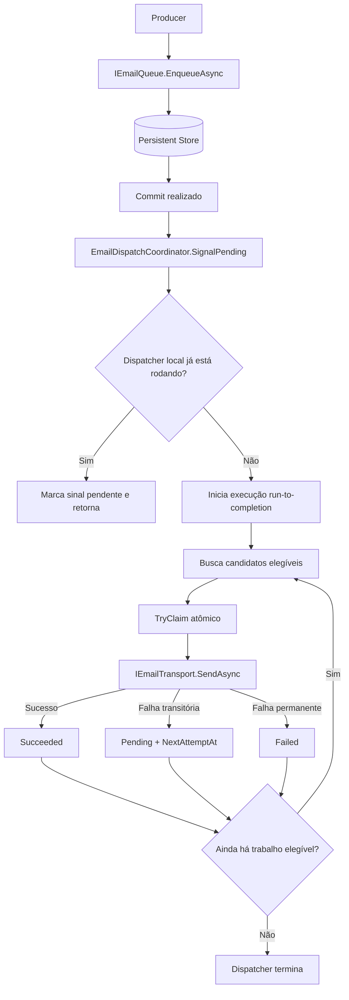
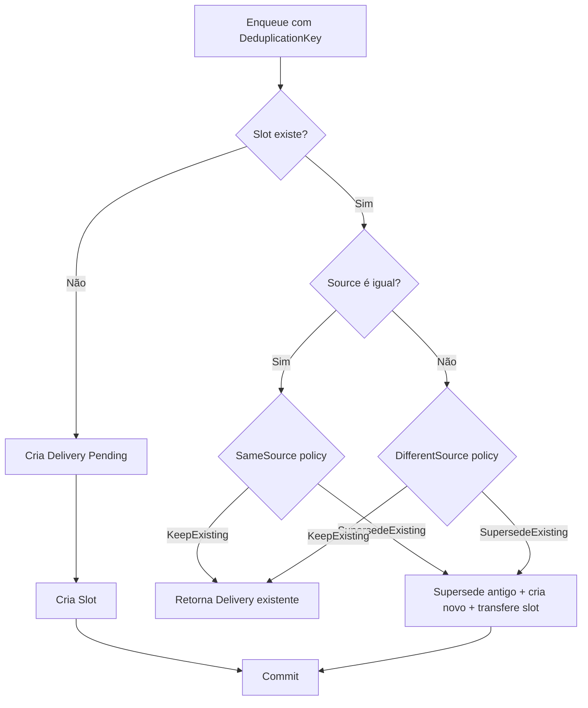
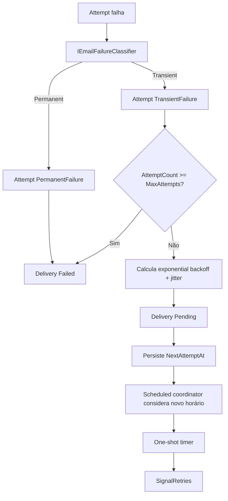
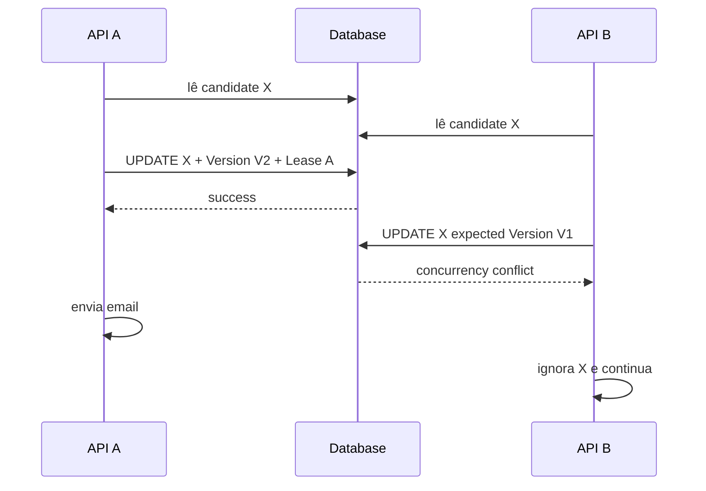
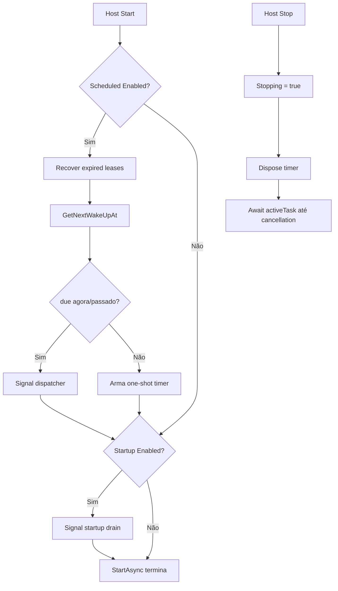

# JadByte.DurableMail — Plano de Implementação v0.1

> **Status:** arquitetura fechada para início da implementação.
>
> **Alvo principal:** .NET 10.
>
> **Package IDs planejados:**
>
> - `JadByte.DurableMail`
> - `JadByte.DurableMail.EntityFrameworkCore`
> - `JadByte.DurableMail.AspNetCore`
> - `JadByte.DurableMail.MailKit`

---

## 1. Objetivo

`JadByte.DurableMail` será uma biblioteca leve para **entrega durável de e-mails fora do request HTTP**, com persistência, tentativas rastreáveis, retry com exponential backoff, deduplicação/supersession e segurança contra concorrência.

A biblioteca **não será um scheduler genérico**, **não será um message broker** e **não será um substituto para Hangfire/Quartz**.

Seu escopo é deliberadamente específico:

```text
Email
Delivery
Persistence
Attempts
Retry
Dispatch
Deduplication
Supersession
Concurrency
Transport
```

Ela não deve conhecer:

```text
ASP.NET Core Identity
/register
/resendConfirmationEmail
CloudFolderVault
MariaDB
MySQL
PostgreSQL
SQL Server
Oracle
qualquer domínio de negócio do consumidor
```

O consumidor integra a biblioteca com seu domínio/framework da forma que desejar.

---

## 2. Decisões arquiteturais não negociáveis da v0.1

1. **Não usar `BackgroundService`.**
2. **Não manter loop permanente.**
3. **Não fazer polling periódico do banco.**
4. **Não manter worker consumindo CPU continuamente.**
5. O processamento será **run-to-completion**: nasce quando sinalizado, drena trabalho elegível e termina.
6. Retry agendado será feito por **timer one-shot**, nunca por timer periódico.
7. A persistência será abstrata no Core.
8. A implementação oficial de persistência será baseada em **EF Core**, sem provider concreto.
9. O consumidor escolhe seu provider EF Core.
10. A biblioteca não distribuirá migrations universais por banco.
11. Concorrência real será garantida pela persistência, não por `IMemoryCache`, middleware ou timer.
12. `IMemoryCache` não será usado como mecanismo de corretude.
13. A entrega terá semântica **at-least-once**.
14. A biblioteca não promete exactly-once para SMTP ou qualquer transporte externo.
15. O Core não referencia EF Core, ASP.NET Core ou MailKit.
16. `JadByte.DurableMail.EntityFrameworkCore` não referencia provider de banco específico.
17. `JadByte.DurableMail.AspNetCore` contém apenas integração HTTP/ASP.NET Core.
18. `JadByte.DurableMail.MailKit` contém apenas transporte SMTP e classificação de falhas específicas do MailKit.
19. Rate limiting de endpoints não pertence à biblioteca.
20. Integração com ASP.NET Core Identity não pertence à biblioteca.

---

## 3. Fluxo principal



O request espera somente a persistência do job. Ele **não espera DNS, conexão TCP, TLS, autenticação SMTP, envio nem resposta do servidor SMTP**.

---

## 4. Retry triggers

Todos os triggers chamam o **mesmo dispatcher**. Nenhum trigger implementa retry por conta própria.

A biblioteca deve permitir combinar livremente:

```csharp
options.Retries.Scheduled.Enabled = true;
options.Retries.Enqueue.Enabled = false;
options.Retries.Middleware.Enabled = false;
options.Retries.Startup.Enabled = false;
```

Defaults oficiais:

```text
Scheduled.Enabled       = true
Enqueue.Enabled         = false
Middleware.Enabled      = false
Middleware.Interval     = 1 minuto
Startup.Enabled         = false
Manual                  = sempre disponível
```

### 4.1 Scheduled — habilitado por padrão

É o mecanismo principal de retry.

Quando existir `NextAttemptAt`, a biblioteca agenda **um único timer one-shot** para o próximo horário conhecido.

```text
falha
↓
NextAttemptAt persistido
↓
one-shot timer armado
↓
nenhum processamento contínuo
↓
timer dispara
↓
SignalRetries()
↓
dispatcher processa
↓
arma o próximo timer, se existir
↓
termina
```

Implementar com `TimeProvider.CreateTimer(...)` e `period: Timeout.InfiniteTimeSpan`.

Não criar timer periódico.

O scheduler local deve manter no máximo um `ITimer` ativo.

### 4.2 Enqueue — desabilitado por padrão

`Dispatch.AutoDispatchOnEnqueue = true` é separado desta opção.

Todo novo job, por padrão, já sinaliza o processamento **dele próprio**.

Quando:

```csharp
options.Retries.Enqueue.Enabled = true;
```

cada enqueue também funciona como oportunidade para procurar retries já vencidos.

Logo:

```text
novo job
↓
processamento normal do novo job
+
scan de retries vencidos
```

Não confundir `Dispatch.AutoDispatchOnEnqueue` com `Retries.Enqueue.Enabled`.

### 4.3 Middleware — desabilitado por padrão

Configuração obrigatória:

```csharp
options.Retries.Middleware.Enabled = true;
options.Retries.Middleware.Interval = TimeSpan.FromMinutes(1);
```

`Interval` possui default de **1 minuto**.

O middleware não acessa banco diretamente.

Fluxo:

```text
HTTP request
↓
MiddlewareRetryGate
↓
intervalo mínimo ainda não venceu?
├─ Sim → next(context)
└─ Não → SignalRetries() → next(context)
```

O gate deve ser local à instância e usado somente como **throttle de sinalização**.

Não usar `IMemoryCache` para isso. Preferir `TimeProvider.GetTimestamp()` + `Interlocked`, pois o timestamp monotônico não sofre com ajuste do relógio de parede.

A proteção distribuída permanece no banco através de claim/lease/concurrency token.

### 4.4 Startup — desabilitado por padrão

Quando habilitado, realiza uma execução única de recuperação/drain durante inicialização.

Útil quando a aplicação esteve offline e o consumidor quer um scan explícito de pendências imediatamente no startup.

Não inicia loop e não permanece rodando.

### 4.5 Manual — sempre disponível

Disponibilizar:

```csharp
public interface IEmailRetryDispatcher
{
    Task<EmailDispatchResult> DispatchDueAsync(
        CancellationToken cancellationToken = default);
}
```

Pode ser utilizado por CLI, endpoint administrativo, cron externo, Kubernetes CronJob, teste ou ferramenta de manutenção.

---

## 5. Recuperação após restart

Existe uma diferença importante entre o trigger opcional `Startup` e a restauração mínima necessária ao `Scheduled`.

Quando `Retries.Scheduled.Enabled == true`, o lifecycle service deve, no startup:

1. verificar leases expirados;
2. descobrir o próximo trabalho elegível;
3. se já estiver vencido, sinalizar processamento;
4. se estiver no futuro, rearmar o timer one-shot.

Isso é **rehydration do agendamento persistido**, não o trigger opcional `Startup`.

Sem essa etapa, um job persistido antes de um crash poderia ficar esquecido após restart.

Se todos os triggers automáticos forem explicitamente desabilitados pelo consumidor, ele aceita que jobs antigos dependam de `Manual`, novo `Enqueue` ou outro gatilho configurado por ele.

---

## 6. Estrutura da solution

```text
JadByte.DurableMail/
├── JadByte.DurableMail.slnx
├── Directory.Build.props
├── Directory.Packages.props
├── global.json
├── README.md
├── CHANGELOG.md
├── LICENSE                     # somente após o autor escolher a licença
├── src/
│   ├── JadByte.DurableMail/
│   │   └── JadByte.DurableMail.csproj
│   ├── JadByte.DurableMail.EntityFrameworkCore/
│   │   └── JadByte.DurableMail.EntityFrameworkCore.csproj
│   ├── JadByte.DurableMail.AspNetCore/
│   │   └── JadByte.DurableMail.AspNetCore.csproj
│   └── JadByte.DurableMail.MailKit/
│       └── JadByte.DurableMail.MailKit.csproj
├── tests/
│   ├── JadByte.DurableMail.Tests/
│   ├── JadByte.DurableMail.EntityFrameworkCore.Tests/
│   ├── JadByte.DurableMail.AspNetCore.Tests/
│   └── JadByte.DurableMail.MailKit.Tests/
└── samples/
    └── JadByte.DurableMail.Sample.MinimalApi/
```

Não criar pacote agregador `All` na v0.1.

---

## 7. Criação inicial dos projetos

Na raiz do repositório:

```bat
dotnet new sln -n JadByte.DurableMail

dotnet new classlib -n JadByte.DurableMail -f net10.0 -o src/JadByte.DurableMail
dotnet new classlib -n JadByte.DurableMail.EntityFrameworkCore -f net10.0 -o src/JadByte.DurableMail.EntityFrameworkCore
dotnet new classlib -n JadByte.DurableMail.AspNetCore -f net10.0 -o src/JadByte.DurableMail.AspNetCore
dotnet new classlib -n JadByte.DurableMail.MailKit -f net10.0 -o src/JadByte.DurableMail.MailKit

dotnet new xunit -n JadByte.DurableMail.Tests -f net10.0 -o tests/JadByte.DurableMail.Tests
dotnet new xunit -n JadByte.DurableMail.EntityFrameworkCore.Tests -f net10.0 -o tests/JadByte.DurableMail.EntityFrameworkCore.Tests
dotnet new xunit -n JadByte.DurableMail.AspNetCore.Tests -f net10.0 -o tests/JadByte.DurableMail.AspNetCore.Tests
dotnet new xunit -n JadByte.DurableMail.MailKit.Tests -f net10.0 -o tests/JadByte.DurableMail.MailKit.Tests

dotnet new webapi -n JadByte.DurableMail.Sample.MinimalApi -f net10.0 -o samples/JadByte.DurableMail.Sample.MinimalApi
```

Adicionar tudo à solution.

---

## 8. Referências entre projetos

Produção:

```text
JadByte.DurableMail.EntityFrameworkCore
    → JadByte.DurableMail

JadByte.DurableMail.AspNetCore
    → JadByte.DurableMail

JadByte.DurableMail.MailKit
    → JadByte.DurableMail
```

Core não referencia nenhum adapter.

Testes:

```text
JadByte.DurableMail.Tests
    → JadByte.DurableMail

JadByte.DurableMail.EntityFrameworkCore.Tests
    → JadByte.DurableMail.EntityFrameworkCore

JadByte.DurableMail.AspNetCore.Tests
    → JadByte.DurableMail.AspNetCore

JadByte.DurableMail.MailKit.Tests
    → JadByte.DurableMail.MailKit
```

Sample referencia os quatro projetos durante desenvolvimento.

---

## 9. Central Package Management

Usar `Directory.Packages.props` para evitar versões divergentes entre projetos.

Versões verificadas em 27/09/2026:

```xml
<Project>
  <PropertyGroup>
    <ManagePackageVersionsCentrally>true</ManagePackageVersionsCentrally>
  </PropertyGroup>

  <ItemGroup>
    <PackageVersion Include="Microsoft.Extensions.DependencyInjection.Abstractions" Version="10.0.12" />
    <PackageVersion Include="Microsoft.Extensions.Logging.Abstractions" Version="10.0.12" />
    <PackageVersion Include="Microsoft.Extensions.Options" Version="10.0.12" />
    <PackageVersion Include="Microsoft.Extensions.Options.ConfigurationExtensions" Version="10.0.12" />
    <PackageVersion Include="Microsoft.Extensions.Hosting.Abstractions" Version="10.0.12" />
    <PackageVersion Include="Microsoft.EntityFrameworkCore" Version="10.0.12" />
    <PackageVersion Include="Microsoft.EntityFrameworkCore.Sqlite" Version="10.0.12" />
    <PackageVersion Include="MailKit" Version="4.18.0" />
    <PackageVersion Include="Microsoft.Extensions.TimeProvider.Testing" Version="10.9.0" />
    <PackageVersion Include="Microsoft.NET.Test.Sdk" Version="18.10.1" />
    <PackageVersion Include="xunit.v3" Version="4.0.1" />
  </ItemGroup>
</Project>
```

Antes de publicar uma versão futura, revisar versões novamente; não tratar essa tabela como política eterna de atualização.

---

## 10. Dependências por projeto

### `JadByte.DurableMail`

Dependências permitidas:

```text
Microsoft.Extensions.DependencyInjection.Abstractions
Microsoft.Extensions.Logging.Abstractions
Microsoft.Extensions.Options
Microsoft.Extensions.Options.ConfigurationExtensions
Microsoft.Extensions.Hosting.Abstractions
```

Não adicionar EF Core, MailKit ou ASP.NET Core.

### `JadByte.DurableMail.EntityFrameworkCore`

```text
Microsoft.EntityFrameworkCore
JadByte.DurableMail
```

Não adicionar `SqlServer`, `Npgsql`, `Pomelo`, Oracle ou SQLite como dependência de produção.

### `JadByte.DurableMail.AspNetCore`

Referenciar Core e adicionar ao `.csproj`:

```xml
<ItemGroup>
  <FrameworkReference Include="Microsoft.AspNetCore.App" />
</ItemGroup>
```

**Não** instalar `Microsoft.AspNetCore.App` como PackageReference.

### `JadByte.DurableMail.MailKit`

```text
MailKit
JadByte.DurableMail
```

---

## 11. `Directory.Build.props`

Centralizar defaults técnicos:

```xml
<Project>
  <PropertyGroup>
    <TargetFramework>net10.0</TargetFramework>
    <Nullable>enable</Nullable>
    <ImplicitUsings>enable</ImplicitUsings>
    <TreatWarningsAsErrors>true</TreatWarningsAsErrors>
    <GenerateDocumentationFile>true</GenerateDocumentationFile>
    <Deterministic>true</Deterministic>
    <AnalysisLevel>latest-recommended</AnalysisLevel>
  </PropertyGroup>
</Project>
```

Não escolher licença em nome do autor. Recomenda-se MIT para uma biblioteca desse tipo, mas essa é uma decisão jurídica/de produto separada.

---

## 12. Package IDs, namespaces e assemblies

Usar exatamente:

```text
PackageId:     JadByte.DurableMail
AssemblyName:  JadByte.DurableMail
RootNamespace: JadByte.DurableMail

PackageId:     JadByte.DurableMail.EntityFrameworkCore
AssemblyName:  JadByte.DurableMail.EntityFrameworkCore
RootNamespace: JadByte.DurableMail.EntityFrameworkCore

PackageId:     JadByte.DurableMail.AspNetCore
AssemblyName:  JadByte.DurableMail.AspNetCore
RootNamespace: JadByte.DurableMail.AspNetCore

PackageId:     JadByte.DurableMail.MailKit
AssemblyName:  JadByte.DurableMail.MailKit
RootNamespace: JadByte.DurableMail.MailKit
```

Não inventar abreviações diferentes entre package, assembly e namespace.

O nome exato deve ser novamente validado no NuGet imediatamente antes da primeira publicação. Na revisão atual não foi encontrado resultado indexado para o ID exato `JadByte.DurableMail`, mas isso não constitui reserva do nome.

---

## 13. API pública mínima do Core

Inicialmente, expor apenas o necessário:

```text
IEmailQueue
IEmailTransport
IEmailFailureClassifier
IEmailRetryDispatcher
IEmailDeliveryMaintenance      # manutenção manual; sem worker automático

EmailMessage
EmailEnqueueRequest
EmailEnqueuePolicy
EmailEnqueueResult
EmailEnqueueOutcome
ActiveDeliveryConflictBehavior
EmailBodyFormat
EmailFailureKind
EmailDispatchResult
DurableMailOptions
IDurableMailBuilder
```

Contratos de storage necessários a adapters externos podem ser públicos em namespace avançado:

```text
JadByte.DurableMail.Storage
```

Todo o restante deve começar como `internal`.

API pública é compromisso de compatibilidade futuro; evitar expor internals prematuramente.

---

## 14. Mensagem pública

```csharp
public enum EmailBodyFormat
{
    Html = 0,
    PlainText = 1
}

public sealed record EmailMessage(
    string Recipient,
    string Subject,
    string Body,
    EmailBodyFormat BodyFormat = EmailBodyFormat.Html);
```

Validar no Core:

- `Recipient` não vazio;
- `Subject` não nulo;
- `Body` não nulo.

Não impor parser SMTP no Core. Validação específica de endereço pertence ao transport adapter.

Attachments ficam fora da v0.1.

---

## 15. Enqueue request

```csharp
public sealed record EmailEnqueueRequest(
    EmailMessage Message,
    string? Source = null,
    string? DeduplicationKey = null,
    EmailEnqueuePolicy? Policy = null);
```

`Source` é metadata semântica fornecida pelo consumidor.

Exemplos possíveis — apenas documentação, nunca hardcoded no Core:

```text
identity:registration
identity:resend-confirmation
billing:invoice
notifications:security-alert
```

`DeduplicationKey` representa uma entrega lógica ativa.

---

## 16. Política de conflito/deduplicação

Não oferecer `Allow` quando existe `DeduplicationKey`.

Se o consumidor quer permitir duplicidade, deve simplesmente omitir a chave.

```csharp
public enum ActiveDeliveryConflictBehavior
{
    KeepExisting = 0,
    SupersedeExisting = 1
}
```

```csharp
public sealed class EmailEnqueuePolicy
{
    public ActiveDeliveryConflictBehavior SameSource { get; init; }
        = ActiveDeliveryConflictBehavior.KeepExisting;

    public ActiveDeliveryConflictBehavior DifferentSource { get; init; }
        = ActiveDeliveryConflictBehavior.KeepExisting;
}
```

Isso evita uma semântica contraditória onde um slot único teria de representar vários jobs ativos.

---

## 17. Resultado do enqueue

```csharp
public enum EmailEnqueueOutcome
{
    Created = 0,
    Existing = 1,
    SupersededAndCreated = 2
}

public sealed record EmailEnqueueResult(
    Guid DeliveryId,
    EmailEnqueueOutcome Outcome);
```

---

## 18. `IEmailQueue`

```csharp
public interface IEmailQueue
{
    Task<EmailEnqueueResult> EnqueueAsync(
        EmailEnqueueRequest request,
        CancellationToken cancellationToken = default);
}
```

`EnqueueAsync` deve:

1. validar request;
2. persistir job de forma durável;
3. aplicar deduplicação/supersession de forma transacional;
4. confirmar commit;
5. somente depois do commit sinalizar processamento;
6. retornar sem aguardar transporte externo.

Nunca sinalizar antes do commit.

---

## 19. Unidade de trabalho da biblioteca

A v0.1 deve tratar o enqueue como uma **unidade de trabalho própria**.

Não reutilizar silenciosamente o `DbContext` do request do consumidor e não chamar `SaveChangesAsync` em um contexto que possa conter alterações de negócio alheias à biblioteca.

A implementação deve criar um scope próprio para a operação de persistência.

Consequência documentada:

> A v0.1 não oferece atomicidade transacional automática entre alterações de negócio do consumidor e o enqueue de DurableMail.

Uma futura integração Outbox/UoW pode ser adicionada separadamente sem contaminar o primeiro release.

---

## 20. Estados persistentes

Persistir explicitamente:

```csharp
internal enum EmailDeliveryStatus
{
    Pending = 0,
    Processing = 1,
    Succeeded = 2,
    Failed = 3,
    Superseded = 4
}
```

Não criar `Retrying`.

Um retry aguardando é simplesmente:

```text
Status = Pending
AttemptCount > 0
NextAttemptAt != null
```

`Canceled` fica fora da v0.1 porque `Superseded` já cobre o caso acordado de desistência em favor de uma entrega mais recente. Adicionar cancelamento manual somente quando existir requisito real.

---

## 21. Outcomes de tentativa

```csharp
internal enum EmailAttemptOutcome
{
    Succeeded = 0,
    TransientFailure = 1,
    PermanentFailure = 2,
    Abandoned = 3
}
```

`Abandoned` representa uma execução iniciada cujo resultado deixou de ser conhecido — por exemplo, processo encerrado após claim.

---

## 22. Modelo persistente EF — interno ao adapter

As entidades EF devem ser `internal` em `JadByte.DurableMail.EntityFrameworkCore`.

O Core não precisa expor entities de banco.

Criar:

```text
Persistence/Entities/
├── EmailDeliveryEntity.cs
├── EmailDeliveryAttemptEntity.cs
└── EmailDeliverySlotEntity.cs
```

### `EmailDeliveryEntity`

Campos mínimos:

```text
Id                          Guid
Recipient                   string
Subject                     string
Body                        string
BodyFormat                  int
Status                      int
Source                      string?
DeduplicationKey            string?
AttemptCount                int
MaxAttempts                 int
CreatedAt                   DateTimeOffset
UpdatedAt                   DateTimeOffset
LastAttemptAt               DateTimeOffset?
NextAttemptAt               DateTimeOffset?
CompletedAt                 DateTimeOffset?
FailedAt                    DateTimeOffset?
SupersededAt                DateTimeOffset?
SupersededByDeliveryId      Guid?
LeaseId                     Guid?
LeaseExpiresAt              DateTimeOffset?
Version                     Guid
```

### `EmailDeliveryAttemptEntity`

```text
Id                          Guid
EmailDeliveryId             Guid
AttemptNumber               int
StartedAt                   DateTimeOffset
FinishedAt                  DateTimeOffset?
Outcome                     int?
ErrorType                   string?
ErrorMessage                string?
StackTrace                  string?
```

### `EmailDeliverySlotEntity`

```text
Key                         string PK
DeliveryId                  Guid
Source                      string?
Version                     Guid
```

---

## 23. Tabelas e colunas

Nomes fixos e previsíveis:

```text
durable_mail_deliveries
durable_mail_attempts
durable_mail_slots
```

Mapear todas as colunas explicitamente em `snake_case`, independentemente da naming convention do consumidor.

Isso evita que o schema da biblioteca mude conforme plugins de naming externos.

Limites recomendados:

```text
Source                  128
DeduplicationKey        256
ErrorType               512
ErrorMessage            4096
StackTrace              16384
```

Não indexar `Body`, `Subject`, `ErrorMessage` ou `StackTrace`.

---

## 24. Índices mínimos

Criar somente índices justificados pelos queries:

```text
(status, next_attempt_at)
(status, created_at)
(status, lease_expires_at)
(email_delivery_id, attempt_number) UNIQUE
slots.key PRIMARY KEY
```

Pode existir índice em `deliveries.deduplication_key` para diagnóstico, mas ele não substitui `slots` como mecanismo de unicidade ativa.

---

## 25. Concorrência otimista provider-agnostic

Não depender de:

```text
SQL Server rowversion
PostgreSQL xmin
SELECT FOR UPDATE
GET_LOCK
sp_getapplock
provider-specific SQL
```

Usar `Guid Version` como concurrency token gerenciado pela aplicação.

EF mapping:

```csharp
builder.Property(x => x.Version)
    .IsConcurrencyToken();
```

Antes de cada transição concorrente relevante:

```csharp
entity.Version = Guid.NewGuid();
```

Se outro processo modificou a linha antes:

```text
DbUpdateConcurrencyException
```

O caller interpreta como claim perdido/conflito esperado, não como falha fatal.

---

## 26. Claim + lease

Nunca fazer:

```text
SELECT Pending
↓
SEND
```

Fluxo obrigatório:

```text
Pending
↓
TryClaim
↓
Processing
↓
LeaseId
LeaseExpiresAt
AttemptCount++
INSERT Attempt
↓
COMMIT
↓
Send
```

Claim e criação da tentativa devem ocorrer na mesma unidade transacional.

Retornar um token de execução interno, por exemplo:

```csharp
internal sealed record ClaimedEmailDelivery(
    Guid DeliveryId,
    Guid AttemptId,
    Guid LeaseId,
    Guid Version,
    int AttemptNumber,
    EmailMessage Message);
```

As operações `MarkSucceeded`, `MarkTransientFailure` e `MarkPermanentFailure` devem validar `LeaseId`/`Version` para impedir que um worker antigo sobrescreva estado após perder a lease.

---

## 27. Lease duration

Default:

```csharp
options.Dispatch.LeaseDuration = TimeSpan.FromMinutes(2);
```

O default deve ser confortavelmente maior que o timeout padrão do transporte MailKit.

Não implementar heartbeat/renovação periódica de lease na v0.1.

Consequência: se o consumidor configurar um transporte capaz de durar mais que `LeaseDuration`, ele deve aumentar a lease.

O dispatcher só deve fazer claim imediatamente antes de executar a entrega. Não reclamar dezenas de jobs e deixá-los esperando numa fila local enquanto a lease expira.

---

## 28. Recuperação de lease expirada

Antes de drenar trabalho elegível, executar recuperação de leases expiradas.

Para cada:

```text
Status = Processing
LeaseExpiresAt <= now
```

1. localizar a tentativa sem `FinishedAt`;
2. marcá-la `Abandoned`;
3. definir `FinishedAt = now`;
4. limpar lease;
5. considerar essa tentativa consumida;
6. se `AttemptCount >= MaxAttempts`, marcar `Failed`;
7. caso contrário, retornar a `Pending` e calcular novo `NextAttemptAt` usando a política de retry.

Não assumir que nenhum e-mail foi enviado. A tentativa fica `Abandoned` justamente porque o resultado externo é desconhecido.

---

## 29. Semântica at-least-once

Exemplo inevitável:

```text
SMTP aceita a mensagem
↓
conexão cai antes da aplicação receber confirmação
↓
aplicação classifica como falha
↓
retry
↓
usuário pode receber duas mensagens
```

A biblioteca deve considerar a entrega **não confirmada** e permitir retry.

Objetivo:

```text
evitar perda silenciosa              ✅
evitar duplicidade causada pela fila ✅
exactly-once em sistema externo      ❌
```

Documentar isso claramente no README.

---

## 30. Deduplicação através de slot

Não usar apenas:

```text
SELECT existe?
↓
INSERT
```

Duas requisições concorrentes poderiam passar pelo SELECT.

`durable_mail_slots.key` é PK e representa a propriedade de uma entrega lógica ativa.

Fluxo transacional:

```text
BEGIN
↓
procura slot
↓
se não existe:
    cria delivery
    cria slot apontando para delivery
↓
se existe:
    aplica política SameSource/DifferentSource
↓
COMMIT
```

Se duas transações tentarem criar o mesmo slot:

```text
A não encontra
B não encontra
A INSERT vence
B INSERT falha
```

Não interpretar códigos específicos do provider.

Ao receber `DbUpdateException` nessa corrida:

1. rollback;
2. abrir nova operação;
3. consultar o slot;
4. se o slot agora existir, tratar como corrida legítima;
5. se continuar inexistente, relançar a exceção original.

---

## 31. Supersession

Exemplo genérico:

```text
Logical Key = account-confirmation:user-123
Source A = registration
Source B = resend-confirmation
```

Configuração:

```text
SameSource      = KeepExisting
DifferentSource = SupersedeExisting
```

Fluxo:

```text
Job A / registration / Pending
↓
chega resend-confirmation
↓
Job A → Superseded
Job B → Pending
slot → Job B
```

Novo resend enquanto Job B está ativo:

```text
same source
↓
KeepExisting
↓
retorna Job B
```

### Supersede de `Pending`

Marcar imediatamente:

```text
Status = Superseded
SupersededAt = now
SupersededByDeliveryId = newId
```

Nenhum retry adicional.

### Supersede de `Processing`

Não fingir que o transporte foi cancelado.

Registrar intenção de supersession, mas deixar a tentativa atual terminar.

Se tentativa atual:

- **suceder:** estado final real deve ser `Succeeded`;
- **falhar:** não agendar retry e finalizar como `Superseded`.

Isso preserva a realidade observável.

---

## 32. Liberação do slot

Liberar ou transferir slot quando uma entrega chegar a estado terminal:

```text
Succeeded  → remove slot se ainda for o proprietário
Failed     → remove slot se ainda for o proprietário
Superseded → slot já deve apontar para o substituto ou ser removido
```

Nunca remover slot apenas pela `DeduplicationKey`; validar que `DeliveryId` ainda corresponde ao proprietário esperado.

---

## 33. Retry options

Configuração pública:

```csharp
options.Retries.MaxAttempts = 5;
options.Retries.InitialDelay = TimeSpan.FromMinutes(2);
options.Retries.BackoffFactor = 2;
options.Retries.MaxDelay = TimeSpan.FromMinutes(30);
options.Retries.JitterRatio = 0.15;
```

`MaxAttempts` representa **tentativas totais**, não “retries adicionais”.

Logo:

```text
MaxAttempts = 5
```

significa no máximo cinco chamadas ao transport.

---

## 34. Exponential backoff

Criar abstração interna ou extensível:

```csharp
public interface IRetryDelayCalculator
{
    TimeSpan Calculate(
        int failedAttemptCount,
        EmailRetryOptions options);
}
```

Default:

```text
baseDelay = InitialDelay * BackoffFactor^(failedAttemptCount - 1)
baseDelay = min(baseDelay, MaxDelay)

jitterWindow = baseDelay * JitterRatio
finalDelay = baseDelay + random(-jitterWindow, +jitterWindow)
```

Clamp final para valor >= zero.

Com defaults:

```text
falha 1 → ~2 min
falha 2 → ~4 min
falha 3 → ~8 min
falha 4 → ~16 min
```

Não chamar progressão linear de exponential backoff.

---

## 35. `TimeProvider`

Nunca espalhar `DateTimeOffset.UtcNow` diretamente.

Registrar default:

```csharp
TimeProvider.System
```

com `TryAddSingleton`, permitindo substituição.

Usar:

```csharp
timeProvider.GetUtcNow()
```

para timestamps persistidos.

Usar `GetTimestamp()`/`GetElapsedTime()` para throttle local de intervalo, como middleware.

Usar `CreateTimer()` para timer one-shot.

Isso torna retries, leases, middleware e agendamento deterministicamente testáveis.

---

## 36. Scheduled coordinator

Criar:

```text
Retries/
├── RetryScheduleCoordinator.cs
├── ExponentialRetryDelayCalculator.cs
└── RetryTriggerReason.cs
```

`RetryScheduleCoordinator` deve ser singleton e possuir no máximo um `ITimer`.

Regras:

```text
novo NextAttemptAt não existe
→ nenhuma ação

não existe timer
→ arma

novo horário é anterior ao atual
→ substitui/reagenda

novo horário é igual ou posterior
→ mantém timer atual
```

Como callback de timer não é async:

```text
callback
↓
SignalRetries(Scheduled)
```

Nunca usar `async void`.

Proteger troca/dispose/rearm do timer contra race. Usar lock pequeno somente para estado local do timer e, se necessário, generation/version local para ignorar callback obsoleto.

---

## 37. Dispatcher run-to-completion

Criar:

```text
Processing/
├── EmailDispatchCoordinator.cs
├── EmailDispatchRunner.cs
├── EmailDeliveryExecutor.cs
├── EmailRetryDispatcher.cs
└── EmailDispatchResult.cs
```

`EmailDispatchCoordinator` é singleton.

Estado local mínimo:

```text
_running
_pendingDispatchSignal
_pendingRetrySignal
_stopping
_activeTask
```

Usar `Interlocked` para single-flight local.

Se já existir processamento:

```text
novo signal
↓
não cria segundo runner
↓
marca pending signal
↓
runner atual reavalia antes de terminar
```

---

## 38. Não usar `Task.Run` por padrão

O pipeline é majoritariamente I/O assíncrono.

O coordinator pode iniciar uma Task async rastreada diretamente:

```text
_activeTask = RunTrackedAsync(...)
```

sem `await` no caller, mas mantendo referência e observando exceções.

Não capturar serviços scoped do request.

O runner cria seus próprios async scopes.

`Task.Run` só deve ser introduzido se surgir trabalho CPU-bound real; não deve ser usado apenas para “tornar algo background”.

---

## 39. Scopes corretos

`EmailDispatchCoordinator` é singleton e injeta `IServiceScopeFactory`.

Cada unidade de execução que precise de scoped services cria:

```csharp
await using var scope = serviceScopeFactory.CreateAsyncScope();
```

Resolve dentro desse scope:

```text
IEmailDeliveryStore
IEmailTransport
IEmailFailureClassifier
EmailDeliveryExecutor
```

Nunca capturar:

```text
DbContext do request
HttpContext
serviço scoped do endpoint
```

---

## 40. Drain loop permitido

É permitido um loop **somente enquanto existe execução ativa**:

```text
buscar batch elegível
↓
processar
↓
ainda há elegíveis?
├─ sim → próximo batch
└─ não → terminar Task
```

Proibido:

```text
while application is alive
```

Quando não há trabalho, não existe dispatcher executando.

---

## 41. Dispatch defaults

```csharp
options.Dispatch.AutoDispatchOnEnqueue = true;
options.Dispatch.BatchSize = 25;
options.Dispatch.MaxDegreeOfParallelism = 1;
options.Dispatch.LeaseDuration = TimeSpan.FromMinutes(2);
```

Começar com paralelismo 1 por previsibilidade e baixo footprint.

Permitir aumento explícito pelo consumidor.

Não calcular paralelismo automaticamente pelo número de CPUs.

Para paralelismo > 1, cada entrega deve usar scope próprio e transporte próprio conforme lifetime configurado.

---

## 42. Query de candidatos

Ordenação recomendada:

1. `NextAttemptAt` quando definido;
2. `CreatedAt`;
3. `Id` como desempate estável.

Um job é elegível quando:

```text
Status = Pending
AND
(
    NextAttemptAt IS NULL
    OR NextAttemptAt <= now
)
```

Jobs `Processing` só voltam após recuperação de lease expirada.

Buscar apenas IDs/campos mínimos necessários antes do claim; evitar tracking de batches grandes.

Claim é feito individualmente/fresh para garantir concorrência.

---

## 43. Fluxo de tentativa

### Claim

Na mesma transação:

```text
Status = Processing
LeaseId = new Guid
LeaseExpiresAt = now + LeaseDuration
AttemptCount++
LastAttemptAt = now
Version = new Guid

INSERT attempt:
    AttemptNumber = AttemptCount
    StartedAt = now
    FinishedAt = null
```

### Envio

```text
await IEmailTransport.SendAsync(...)
```

### Sucesso

```text
attempt:
    FinishedAt = now
    Outcome = Succeeded

job:
    Status = Succeeded
    CompletedAt = now
    NextAttemptAt = null
    LeaseId = null
    LeaseExpiresAt = null
    Version = new Guid
```

Liberar slot apenas se o job ainda for proprietário.

### Falha transitória

```text
attempt:
    FinishedAt
    Outcome = TransientFailure
    ErrorType
    ErrorMessage
    StackTrace
```

Se:

```text
AttemptCount < MaxAttempts
```

então:

```text
Status = Pending
NextAttemptAt = now + calculatedDelay
Lease = null
```

Caso contrário:

```text
Status = Failed
FailedAt = now
NextAttemptAt = null
```

### Falha permanente

```text
Outcome = PermanentFailure
Status = Failed
FailedAt = now
NextAttemptAt = null
```

Nunca retry automático para permanent failure.

---

## 44. Transporte

Core:

```csharp
public interface IEmailTransport
{
    Task SendAsync(
        EmailMessage message,
        CancellationToken cancellationToken = default);
}
```

Não expor SMTP no Core.

Um consumidor pode implementar:

```text
SMTP
SendGrid
SES
Postmark
Mailgun
Resend
API própria
```

---

## 45. Failure classifier

```csharp
public enum EmailFailureKind
{
    Transient = 0,
    Permanent = 1
}

public interface IEmailFailureClassifier
{
    EmailFailureKind Classify(Exception exception);
}
```

O Core fornece um classificador conservador default para transports customizados:

```text
exception desconhecida → Transient
```

Motivo: `MaxAttempts` limita retry infinito e, para e-mail importante, é preferível tentar novamente do que descartar por classificação incompleta.

Adapters especializados podem substituir essa decisão.

---

## 46. MailKit adapter

Estrutura:

```text
JadByte.DurableMail.MailKit/
├── MailKitEmailTransport.cs
├── MailKitFailureClassifier.cs
├── MailKitOptions.cs
├── MailKitSecurityMode.cs
└── DependencyInjectionExtensions.cs
```

### `MailKitSecurityMode`

```csharp
public enum MailKitSecurityMode
{
    Auto = 0,
    StartTls = 1,
    StartTlsWhenAvailable = 2,
    SslOnConnect = 3,
    None = 4
}
```

Mapear explicitamente para `MailKit.Security.SecureSocketOptions`.

Default:

```text
Port = 587
SecurityMode = StartTls
Timeout = 30 segundos
```

### `MailKitOptions`

```csharp
public sealed class MailKitOptions
{
    public string Host { get; set; } = string.Empty;
    public int Port { get; set; } = 587;
    public string? Username { get; set; }
    public string? Password { get; set; }
    public string FromEmail { get; set; } = string.Empty;
    public string? FromName { get; set; }
    public MailKitSecurityMode SecurityMode { get; set; }
        = MailKitSecurityMode.StartTls;
    public TimeSpan Timeout { get; set; }
        = TimeSpan.FromSeconds(30);
}
```

Validar no startup.

Nunca logar Password.

Criar um `SmtpClient` por envio; não compartilhar uma instância simultaneamente entre deliveries.

---

## 47. MailKit failure classification

No mínimo classificar como transitório:

```text
TimeoutException
IOException
SocketException
falhas de conexão
falhas de protocolo recuperáveis
respostas SMTP 4xx
```

Classificar como permanente quando claramente definitivo:

```text
credenciais/autenticação inválidas
endereço sintaticamente inválido
resposta SMTP 5xx que represente rejeição permanente
configuração inválida
```

Não basear classificação em texto de mensagem de exception quando houver propriedades/códigos estruturados disponíveis.

Exception desconhecida continua conservadoramente transitória, respeitando `MaxAttempts`.

---

## 48. Options model

Criar:

```text
Configuration/
├── DurableMailOptions.cs
├── EmailDispatchOptions.cs
├── EmailRetryOptions.cs
├── ScheduledRetryTriggerOptions.cs
├── EnqueueRetryTriggerOptions.cs
├── MiddlewareRetryTriggerOptions.cs
└── StartupRetryTriggerOptions.cs
```

Forma esperada:

```csharp
public sealed class DurableMailOptions
{
    public EmailDispatchOptions Dispatch { get; set; } = new();
    public EmailRetryOptions Retries { get; set; } = new();
}
```

### Defaults fechados

```text
Dispatch.AutoDispatchOnEnqueue       true
Dispatch.BatchSize                   25
Dispatch.MaxDegreeOfParallelism      1
Dispatch.LeaseDuration               2 minutos

Retries.MaxAttempts                  5
Retries.InitialDelay                 2 minutos
Retries.BackoffFactor                2
Retries.MaxDelay                     30 minutos
Retries.JitterRatio                  0.15

Retries.Scheduled.Enabled            true
Retries.Enqueue.Enabled              false
Retries.Middleware.Enabled           false
Retries.Middleware.Interval          1 minuto
Retries.Startup.Enabled              false
```

Manual sempre disponível.

---

## 49. Options validation

Implementar `IValidateOptions<DurableMailOptions>`.

Regras mínimas:

```text
BatchSize > 0
MaxDegreeOfParallelism > 0
LeaseDuration > 0
MaxAttempts >= 1
InitialDelay > 0
BackoffFactor >= 1
MaxDelay >= InitialDelay
JitterRatio >= 0
JitterRatio < 1
Middleware.Interval > 0 quando Middleware.Enabled
```

Executar `ValidateOnStart()`.

Não permitir configuração inválida chegar ao primeiro e-mail de produção.

---

## 50. Lifetimes no DI

Recomendação:

```text
DurableMailOptions validator             Singleton
TimeProvider                             Singleton
EmailDispatchCoordinator                 Singleton
RetryScheduleCoordinator                 Singleton
MiddlewareRetryGate                      Singleton
DurableMailLifecycleService              Singleton/IHostedService

IEmailQueue implementation               Transient ou Scoped
IEmailDeliveryStore                      Scoped
EmailDeliveryExecutor                    Scoped/Transient
IEmailTransport                          Transient por default
IEmailFailureClassifier                  Singleton se stateless
IEmailRetryDispatcher                    Transient/Scoped façade
```

Usar `TryAdd...` para defaults que o consumidor deve conseguir substituir.

Não construir `ServiceProvider` manualmente dentro de registration extensions.

---

## 51. Lifecycle service — permitido, mas não é worker

Criar internamente:

```text
DurableMailLifecycleService : IHostedService
```

Ele não possui `ExecuteAsync`, loop ou polling.

### `StartAsync`

```text
se Scheduled.Enabled:
    recuperar estado necessário
    recuperar leases vencidas
    descobrir próximo trabalho
    sinalizar imediatamente ou armar one-shot timer

se Startup.Enabled:
    emitir sinal de drain startup

retornar
```

### `StopAsync`

```text
marcar coordinator como stopping
cancelar/dispose timer
recusar novos signals locais
aguardar activeTask até o CancellationToken do host
```

Se o processo morrer abruptamente, a lease persistida protege recuperação posterior.

---

## 52. Middleware package

Estrutura:

```text
JadByte.DurableMail.AspNetCore/
└── RetryMiddleware/
    ├── DurableMailRetryMiddleware.cs
    ├── MiddlewareRetryGate.cs
    └── ApplicationBuilderExtensions.cs
```

Extensão explícita:

```csharp
app.UseDurableMailRetryTrigger();
```

Não usar `IStartupFilter` para injetar middleware magicamente.

O pipeline deve continuar visível ao consumidor.

Quando middleware estiver desabilitado:

```csharp
await next(context);
```

sem qualquer consulta ao banco.

Quando habilitado e intervalo não venceu, apenas segue a request.

Quando intervalo venceu, sinaliza o coordinator e segue sem aguardar o processamento.

---

## 53. EF Core adapter

Estrutura:

```text
JadByte.DurableMail.EntityFrameworkCore/
├── DependencyInjectionExtensions.cs
├── ModelBuilderExtensions.cs
└── Persistence/
    ├── EfEmailDeliveryStore.cs
    ├── Entities/
    │   ├── EmailDeliveryEntity.cs
    │   ├── EmailDeliveryAttemptEntity.cs
    │   └── EmailDeliverySlotEntity.cs
    └── Configurations/
        ├── EmailDeliveryConfiguration.cs
        ├── EmailDeliveryAttemptConfiguration.cs
        └── EmailDeliverySlotConfiguration.cs
```

O package depende apenas de `Microsoft.EntityFrameworkCore`.

---

## 54. Integração EF pelo consumidor

API planejada:

```csharp
builder.Services
    .AddDurableMail(options =>
    {
        // options
    })
    .UseEntityFrameworkCore<ApplicationDbContext>()
    .UseMailKit(options =>
    {
        // smtp
    });
```

No DbContext do consumidor:

```csharp
protected override void OnModelCreating(ModelBuilder modelBuilder)
{
    base.OnModelCreating(modelBuilder);

    modelBuilder.AddDurableMail();
}
```

Depois o consumidor gera migration usando **o próprio provider**:

```bat
dotnet ef migrations add AddDurableMail
dotnet ef database update
```

Não distribuir uma migration única para todos os providers.

---

## 55. Compatibilidade de banco

README deve dizer de forma explícita:

> `JadByte.DurableMail.EntityFrameworkCore` é provider-agnostic e utiliza o provider EF Core configurado pelo consumidor. A compatibilidade concreta com um banco é responsabilidade/capacidade do provider escolhido. O projeto só deve listar bancos como “testados oficialmente” depois que existirem testes reais para eles.

Não prometer:

```text
Supports every EF Core database
```

sem matriz de testes.

---

## 56. Contrato do store

O Core deve expor um contrato de persistence adapter suficientemente pequeno.

Uma forma recomendada:

```csharp
public interface IEmailDeliveryStore
{
    Task<EmailEnqueueResult> EnqueueAsync(
        EmailEnqueueStoreRequest request,
        CancellationToken cancellationToken);

    Task<IReadOnlyList<Guid>> GetEligibleDeliveryIdsAsync(
        DateTimeOffset now,
        int take,
        CancellationToken cancellationToken);

    Task<ClaimedEmailDelivery?> TryClaimAsync(
        Guid deliveryId,
        DateTimeOffset now,
        TimeSpan leaseDuration,
        CancellationToken cancellationToken);

    Task<bool> MarkSucceededAsync(...);
    Task<bool> MarkTransientFailureAsync(...);
    Task<bool> MarkPermanentFailureAsync(...);

    Task<int> RecoverExpiredLeasesAsync(...);

    Task<DateTimeOffset?> GetNextWakeUpAtAsync(
        DateTimeOffset now,
        CancellationToken cancellationToken);
}
```

Os DTOs do namespace `Storage` não devem expor EF types.

---

## 57. `GetNextWakeUpAtAsync`

Não consultar apenas retries.

O próximo wake-up deve considerar:

```text
Pending sem tentativa inicial         → agora
Pending com NextAttemptAt <= now      → agora
Processing com lease vencida          → agora
Pending com retry futuro              → menor NextAttemptAt
```

Isso é essencial para recuperar um job persistido caso o processo morra imediatamente após commit e antes do dispatch local iniciar.

---

## 58. Retry schedule após cada mudança

Sempre que uma operação persistir um novo `NextAttemptAt` potencialmente mais cedo que o timer conhecido:

```text
store commit
↓
RetryScheduleCoordinator.Consider(nextAttemptAt)
```

Depois de um drain completo:

```text
GetNextWakeUpAtAsync
↓
reconciliar timer
```

Persistência é fonte da verdade; timer é apenas otimização/executor local.

---

## 59. Multi-instância

Exemplo:

```text
API A        API B
  ↓            ↓
mesmo job candidato
  ↓            ↓
TryClaim     TryClaim
  ↓            ↓
A vence      B recebe conflito
```

B não envia e segue para outro item.

Não usar triggers para exclusão mútua distribuída.

Não assumir sticky sessions.

---

## 60. Observabilidade e histórico

Toda tentativa deve ser persistida.

Exemplo reconstruível:

```text
Delivery 123

Attempt 1
Started:  10:03:11Z
Finished: 10:03:21Z
Outcome:  TransientFailure
Type:     SocketException

Attempt 2
Started:  10:05:25Z
Finished: 10:05:55Z
Outcome:  TransientFailure
Type:     TimeoutException

Attempt 3
Started:  10:10:02Z
Finished: 10:10:03Z
Outcome:  Succeeded
```

A tabela principal representa estado atual; a tabela de attempts representa histórico imutável.

Não sobrescrever attempts antigos.

---

## 61. Logging

Usar structured logging.

Eventos mínimos:

```text
Delivery enqueued
Existing delivery reused
Delivery superseded
Delivery claimed
Attempt started
Attempt succeeded
Attempt transiently failed
Attempt permanently failed
Retry scheduled
Delivery exhausted attempts
Expired lease recovered
Scheduled timer armed/rearmed
Dispatcher started/stopped
```

Usar `LoggerMessage` source generator para hot paths internos.

Nunca logar:

```text
Body
confirmation links
password-reset code
password-reset token
SMTP password
credentials
```

---

## 62. Persistência de dados sensíveis

A biblioteca persiste `Subject` e `Body`.

Isso pode incluir:

```text
confirmation token
password-reset link
password-reset code
informação pessoal
```

README deve declarar as tabelas como **dados sensíveis**.

Não implementar criptografia caseira.

Na v0.1, criptografia/proteção de payload fica fora do escopo; um adapter/protector opcional pode ser estudado futuramente.

---

## 63. Error trace

Antes de persistir exceptions, limitar tamanho para evitar crescimento patológico.

Recomendação interna:

```text
ErrorType      max 512
ErrorMessage   max 4096
StackTrace     max 16384
```

Truncar de forma segura antes de persistir.

Não deixar uma exception gigantesca impedir que o próprio erro seja registrado.

---

## 64. Retenção / crescimento do banco

Uma biblioteca durável não pode ignorar crescimento infinito das tabelas.

A v0.1 **não deve criar cleaner periódico** porque violaria a filosofia de ausência de processos permanentes.

Fornecer manutenção manual:

```csharp
public interface IEmailDeliveryMaintenance
{
    Task<EmailMaintenanceResult> PruneAsync(
        EmailPruneRequest request,
        CancellationToken cancellationToken = default);
}
```

Permitir remover estados terminais mais antigos que cutoffs configurados pelo caller.

Nunca remover `Pending` ou `Processing` por retenção comum.

Nenhum prune automático fica habilitado por padrão.

O consumidor pode chamar manualmente ou por scheduler externo.

---

## 65. Rate limiting

Explicitamente fora do escopo.

O consumidor ASP.NET Core utiliza `Microsoft.AspNetCore.RateLimiting` e políticas por endpoint quando necessário.

`JadByte.DurableMail` não deve criar rate limiter próprio para `/resendConfirmationEmail` ou qualquer endpoint.

---

## 66. Integração com ASP.NET Core Identity

Fora dos packages oficiais da biblioteca.

Um consumidor pode criar um adapter:

```text
IEmailSender<ApplicationUser>
↓
IEmailQueue
```

Exemplo conceitual:

```text
registration:
    Source = identity:registration
    DeduplicationKey = identity:email-confirmation:<user-id>

resend confirmation:
    Source = identity:resend-confirmation
    DeduplicationKey = identity:email-confirmation:<user-id>
```

Política:

```text
SameSource      = KeepExisting
DifferentSource = SupersedeExisting
```

Mas atenção: `IEmailSender<TUser>.SendConfirmationLinkAsync` não informa se foi chamado por registration ou resend. O adapter do consumidor precisa receber essa informação de outra camada; a biblioteca não deve inferir `HttpContext.Request.Path`.

---

## 67. DI builder

Criar:

```csharp
public interface IDurableMailBuilder
{
    IServiceCollection Services { get; }
}
```

Uso esperado:

```csharp
builder.Services
    .AddDurableMail(options =>
    {
        options.Dispatch.AutoDispatchOnEnqueue = true;

        options.Retries.MaxAttempts = 5;
        options.Retries.InitialDelay = TimeSpan.FromMinutes(2);
        options.Retries.BackoffFactor = 2;
        options.Retries.MaxDelay = TimeSpan.FromMinutes(30);
        options.Retries.JitterRatio = 0.15;

        options.Retries.Scheduled.Enabled = true;
        options.Retries.Enqueue.Enabled = false;
        options.Retries.Middleware.Enabled = false;
        options.Retries.Middleware.Interval = TimeSpan.FromMinutes(1);
        options.Retries.Startup.Enabled = false;
    })
    .UseEntityFrameworkCore<ApplicationDbContext>()
    .UseMailKit(options =>
    {
        options.Host = "smtp.example.com";
        options.Port = 587;
        options.FromEmail = "no-reply@example.com";
    });
```

Também pode existir overload para `IConfigurationSection`, usando Options binding.

Não chamar `BuildServiceProvider()` dentro das extensions.

---

## 68. Middleware usage

Quando o consumidor instalar `JadByte.DurableMail.AspNetCore` e habilitar o trigger:

```csharp
app.UseDurableMailRetryTrigger();
```

A chamada deve ser explícita mesmo se `Enabled=false`.

Documentar ordem recomendada no pipeline, mas o middleware não deve depender de autenticação/autorização para funcionar.

Ele não bloqueia o request aguardando retry processing.

---

## 69. Cancellation

Todos os métodos async públicos recebem:

```csharp
CancellationToken cancellationToken = default
```

Shutdown/cancelamento não deve marcar automaticamente entrega como permanent failure.

Se transporte é cancelado durante shutdown e não há tempo seguro para persistir estado final, deixar a lease expirar e permitir recovery posterior.

Nunca esconder `OperationCanceledException` quando cancellation foi solicitado pelo token correspondente.

---

## 70. Exceptions públicas

Manter mínimo:

```text
DurableMailException
DurableMailConfigurationException
EmailTransportException
```

Não expor exception específica para cada estado interno.

Concurrency conflict esperado é fluxo interno, não exception pública.

---

## 71. Testes — ferramentas

Testes recomendados:

```text
xunit.v3 4.0.1
Microsoft.NET.Test.Sdk 18.10.1
Microsoft.Extensions.TimeProvider.Testing 10.9.0
Microsoft.EntityFrameworkCore.Sqlite 10.0.12
```

Usar `FakeTimeProvider` para avançar tempo deterministicamente.

Para EF, preferir SQLite relacional em arquivo temporário nos testes de concorrência.

**Não usar EF Core InMemory provider para validar transações, constraints ou concorrência relacional.**

---

## 72. Testes Core obrigatórios

Cobrir pelo menos:

```text
enqueue simples
enqueue sem deduplication key
same key + same source + KeepExisting
same key + different source + KeepExisting
same key + different source + SupersedeExisting
race de dois enqueues simultâneos
sucesso na primeira tentativa
transient failure
permanent failure
MaxAttempts
backoff 2/4/8
jitter dentro do range
single-flight local
novo signal enquanto runner está ativo
cancelamento
supersession Pending
supersession Processing
```

---

## 73. Testes EF obrigatórios

```text
mapeamento cria três tabelas
PK do slot impede duplicidade
attempt number unique por delivery
Guid concurrency token produz DbUpdateConcurrencyException
claim concorrente entre contextos diferentes
lease expiration
recovery de lease
slot ownership seguro
supersession transacional
race INSERT slot + reconsulta
status/index queries
```

Executar concorrência com instâncias distintas de DbContext.

---

## 74. Testes de trigger obrigatórios

### Scheduled

```text
timer one-shot
não há callback repetitivo
reagenda quando surge horário mais cedo
não reprograma desnecessariamente para horário posterior
rehydration após startup
due no passado → sinal imediato
```

### Middleware

```text
disabled → só chama next
enabled → primeiro request sinaliza
segundo request antes de 1 min não sinaliza
após FakeTimeProvider avançar 1 min sinaliza novamente
requests concorrentes não geram N sinais
```

### Enqueue

```text
Retry trigger disabled → não faz scan extra
Retry trigger enabled → sinaliza retries vencidos
```

### Startup

```text
disabled → sem drain extra
enabled → um único signal
```

---

## 75. Testes de MailKit

Testar:

```text
options validation
SecurityMode mapping
message PlainText
message Html
FromName opcional
Username/Password opcionais em conjunto coerente
timeout aplicado
classifier SMTP 4xx
classifier SMTP 5xx
classifier timeout/socket
não vazar password em logs/exceptions próprias
```

SMTP real não é necessário em unit tests.

Pode existir suite de integration test opcional contra servidor SMTP de teste em container futuramente.

---

## 76. Fake transport

No projeto de testes Core, criar `FakeEmailTransport` configurável para:

```text
succeed
fail transient N times
fail permanently
delay
block until cancellation
record messages sent
```

Permite testar dispatcher sem MailKit.

---

## 77. Documentação XML

Como é biblioteca pública, toda API pública deve possuir XML docs em inglês:

```text
public interfaces
public records/classes
public enums
public properties
public extension methods
```

Comentários internos continuam somente quando explicarem **por que**, não o que o código já diz.

---

## 78. README mínimo antes do primeiro NuGet

Documentar:

```text
What JadByte.DurableMail is
What it is not
No permanent BackgroundService
No polling
Run-to-completion dispatcher
One-shot scheduled trigger
Default retry trigger configuration
Middleware Interval default = 1 minute
EF Core persistence model
Provider compatibility policy
Migrations setup
Concurrency model
Lease model
At-least-once semantics
Deduplication
Supersession
Retry/backoff
Multi-instance behavior
Sensitive payload warning
Manual maintenance/pruning
ASP.NET Core middleware usage
MailKit adapter
Custom transport example
Identity integration note
```

---

## 79. NuGet packaging

Versão inicial recomendada:

```text
0.1.0
```

Não começar em `1.0.0` enquanto API/persistência ainda estão amadurecendo.

Nos `.csproj` packable configurar, depois que decisões legais/repositório forem confirmadas:

```xml
<PropertyGroup>
  <PackageId>JadByte.DurableMail</PackageId>
  <Authors>JadByte</Authors>
  <Description>Durable, retryable email delivery for .NET without a permanent background worker.</Description>
  <PackageTags>email;durable;retry;queue;dotnet;aspnetcore;entityframeworkcore</PackageTags>
  <PackageReadmeFile>README.md</PackageReadmeFile>
  <RepositoryType>git</RepositoryType>
</PropertyGroup>
```

Não preencher `PackageLicenseExpression` ou `RepositoryUrl` até o autor confirmar esses valores.

Todos os packages do conjunto devem compartilhar a mesma versão no início para simplificar compatibilidade.

Após existir uma release estável, considerar `EnablePackageValidation` e baseline para detectar breaking changes.

---

## 80. CI mínima

Pipeline de PR/release deve executar:

```text
dotnet restore
dotnet format --verify-no-changes
dotnet build -c Release --no-restore
dotnet test -c Release --no-build
dotnet pack -c Release --no-build
```

Falhar em warnings.

Não publicar NuGet diretamente de PR.

Publicação deve ocorrer somente a partir de tag/release aprovada.

---

## 81. Fluxograma de deduplicação/supersession



---

## 82. Fluxograma de retry



---

## 83. Fluxograma multi-instância



---

## 84. Fluxograma de lifecycle



---

## 85. Ordem exata de implementação para o Codex

Executar nesta ordem para minimizar retrabalho:

1. Criar repository/solution e estrutura de pastas.
2. Criar `Directory.Build.props`, `Directory.Packages.props` e `global.json`.
3. Criar quatro projetos de produção.
4. Criar quatro projetos de teste.
5. Criar sample Minimal API.
6. Configurar project references.
7. Configurar PackageId/AssemblyName/RootNamespace de cada package.
8. Adicionar dependências conforme seção 10.
9. Implementar contratos públicos básicos do Core.
10. Implementar `DurableMailOptions` e sub-options com defaults fechados.
11. Implementar `IValidateOptions<DurableMailOptions>`.
12. Implementar `TimeProvider.System` via `TryAddSingleton`.
13. Implementar `IEmailTransport`.
14. Implementar `IEmailFailureClassifier` + classificador conservador default.
15. Implementar `IRetryDelayCalculator` + exponential backoff/jitter.
16. Definir storage contracts e DTOs sem EF types.
17. Implementar `EmailDispatchCoordinator` single-flight.
18. Implementar runner run-to-completion sem `Task.Run` obrigatório.
19. Implementar executor de uma delivery.
20. Implementar retry dispatcher manual.
21. Implementar `RetryScheduleCoordinator` one-shot.
22. Implementar `DurableMailLifecycleService : IHostedService` sem loop.
23. Implementar `IEmailQueue` e enqueue workflow.
24. Implementar signal pós-commit.
25. Implementar `Retries.Enqueue` oportunista.
26. Criar EF adapter entities internas.
27. Criar EF configurations explícitas snake_case.
28. Criar `ModelBuilder.AddDurableMail()`.
29. Implementar `EfEmailDeliveryStore<TContext>`.
30. Implementar concorrência por GUID Version.
31. Implementar claim + attempt atomicamente.
32. Implementar lease recovery.
33. Implementar dedup slot transacional.
34. Implementar supersession.
35. Implementar `GetNextWakeUpAtAsync` incluindo pending inicial, retry e lease vencida.
36. Implementar `UseEntityFrameworkCore<TContext>()`.
37. Implementar package MailKit.
38. Implementar MailKit options validation.
39. Implementar failure classifier MailKit.
40. Implementar package ASP.NET Core.
41. Implementar `MiddlewareRetryGate` com monotonic timestamp + Interlocked.
42. Implementar middleware e `UseDurableMailRetryTrigger()`.
43. Implementar manutenção manual/pruning.
44. Criar logs estruturados com `LoggerMessage`.
45. Criar testes Core.
46. Criar testes EF em SQLite relacional.
47. Criar testes de concorrência com contextos separados.
48. Criar testes de scheduled/startup/enqueue/manual triggers.
49. Criar testes middleware com `FakeTimeProvider`.
50. Criar testes MailKit classifier/options.
51. Montar sample Minimal API completo.
52. Escrever README.
53. Escrever CHANGELOG inicial.
54. Rodar `dotnet format`.
55. Rodar build Release com warnings como errors.
56. Rodar toda suíte de testes.
57. Rodar `dotnet pack` para os quatro packages.
58. Inspecionar `.nupkg` antes de publicar.
59. Validar novamente disponibilidade de todos os Package IDs no NuGet.
60. Publicar inicialmente como `0.1.0` somente após revisão manual.

---

## 86. Critérios de aceite obrigatórios

A v0.1 só está pronta quando todos forem verdadeiros:

```text
[ ] Target principal é net10.0.
[ ] Package principal chama-se JadByte.DurableMail.
[ ] Adapters possuem PackageIds JadByte.DurableMail.*.
[ ] Nenhum BackgroundService existe.
[ ] Nenhum loop permanente existe.
[ ] Nenhum polling periódico existe.
[ ] Sem trabalho, nenhum dispatcher continua executando.
[ ] Scheduled usa ITimer one-shot.
[ ] Scheduled é o único retry trigger habilitado por padrão.
[ ] Middleware está desabilitado por padrão.
[ ] Middleware.Interval default é 1 minuto.
[ ] Enqueue retry trigger está desabilitado por padrão.
[ ] Startup retry trigger está desabilitado por padrão.
[ ] Manual dispatch está sempre disponível.
[ ] AutoDispatchOnEnqueue está habilitado por padrão.
[ ] Request nunca aguarda o transporte de e-mail.
[ ] Enqueue só sinaliza após commit.
[ ] Todas as tentativas são persistidas.
[ ] MaxAttempts representa total de tentativas.
[ ] Retry usa exponential backoff.
[ ] Retry possui jitter.
[ ] Permanent failure não faz retry.
[ ] Transient failure pode fazer retry.
[ ] Tentativas esgotadas resultam em Failed.
[ ] Sucesso resulta em Succeeded.
[ ] Superseded não recebe retries futuros.
[ ] Processing abandonado é recuperável por lease.
[ ] Lease expirada registra Attempt Abandoned.
[ ] Claim concorrente é protegido pelo banco.
[ ] Concorrência usa token Guid provider-agnostic.
[ ] Um worker stale não sobrescreve lease mais nova.
[ ] Deduplicação é transacional.
[ ] Race de criação de slot é tratada sem códigos específicos de provider.
[ ] Slot é liberado somente pelo proprietário correto.
[ ] Core não conhece EF Core.
[ ] Core não conhece ASP.NET Core.
[ ] Core não conhece MailKit.
[ ] EF adapter não referencia provider concreto.
[ ] Biblioteca não conhece ASP.NET Core Identity.
[ ] Biblioteca não conhece endpoint HTTP específico.
[ ] Biblioteca não promete exactly-once.
[ ] Body/tokens/secrets nunca são escritos em logs.
[ ] Payload persistido é documentado como sensível.
[ ] Existe estratégia manual de pruning/retention.
[ ] EF InMemory não é usado como prova de comportamento relacional.
[ ] TimeProvider é usado para relógio/testes.
[ ] FakeTimeProvider cobre delays, timer e middleware interval.
[ ] Todos os métodos async públicos aceitam CancellationToken.
[ ] API pública possui XML documentation.
[ ] Build Release não possui warnings.
[ ] dotnet format passa sem alterações.
[ ] Todos os testes passam.
[ ] Os quatro packages são gerados por dotnet pack.
```

---

## 87. Não objetivos da v0.1

Não implementar agora:

```text
Dashboard
Recurring jobs genéricos
Cron
Message broker
RabbitMQ
Kafka
Redis
Hangfire
Quartz
Attachments
Templates completos
Editor de template
Exactly-once
Transactional Outbox genérico
Atomicidade com UoW do consumidor
Criptografia própria de payload
Distributed cache
Automatic periodic cleanup
Rate limiting
ASP.NET Core Identity integration package
Admin UI
```

Esses itens somente entram quando existir requisito real.

---

## 88. Backlog futuro possível

Sem compromisso com v0.1:

```text
JadByte.DurableMail.Identity
JadByte.DurableMail.DataProtection
payload encryption/protection
transactional outbox integration
custom retention triggers
provider integration test matrix
OpenTelemetry Activity/Metrics
admin/query API
dashboard separado
attachment support
template abstractions
bulk enqueue
priority lanes
lease renewal para transports long-running
```

Não antecipar esses recursos na arquitetura atual além de evitar bloquear sua adição futura.

---

## 89. Referências técnicas validadas durante a revisão

A implementação deve continuar alinhada às seguintes documentações oficiais:

- Microsoft Learn — `TimeProvider.CreateTimer`: `period = Timeout.InfiniteTimeSpan` desabilita sinalização periódica e permite comportamento one-shot.
- Microsoft Learn — EF Core Handling Concurrency Conflicts: concurrency token gerenciado pela aplicação com `Guid` é suportado e provider-agnostic.
- Microsoft Learn — EF Core Migrations with Multiple Providers: migrations são geradas para o provider ativo; não existe migration universal automática para todos os providers.
- Microsoft Learn — Dependency Injection: background/lifecycle code que utiliza scoped services deve criar scope próprio via `IServiceScopeFactory`.
- Microsoft Learn — ASP.NET Core Best Practices: não capturar `DbContext`/serviços scoped do request em trabalho assíncrono desacoplado.
- Microsoft Learn — ASP.NET Core Rate Limiting: rate limiting pertence ao pipeline HTTP do consumidor e pode ser aplicado por endpoint/policy.
- NuGet — Microsoft.EntityFrameworkCore 10.0.12.
- NuGet — Microsoft.Extensions.* 10.0.12.
- NuGet — MailKit 4.18.0.
- NuGet — Microsoft.Extensions.TimeProvider.Testing 10.9.0.
- NuGet — xunit.v3 4.0.1.
- NuGet — Microsoft.NET.Test.Sdk 18.10.1.

Revalidar versões imediatamente antes da primeira release NuGet.

---

## 90. Resumo da arquitetura fechada

```text
JadByte.DurableMail
│
├── Core
│   ├── enqueue
│   ├── retry policy
│   ├── dispatcher run-to-completion
│   ├── single-flight local
│   ├── one-shot scheduling
│   ├── lifecycle start/stop
│   └── abstrações de store/transport
│
├── JadByte.DurableMail.EntityFrameworkCore
│   ├── persistência durável
│   ├── claim
│   ├── lease
│   ├── optimistic concurrency
│   ├── attempts
│   ├── deduplication slot
│   └── supersession
│
├── JadByte.DurableMail.AspNetCore
│   └── middleware retry trigger opcional
│
└── JadByte.DurableMail.MailKit
    ├── SMTP transport
    └── failure classification
```

Princípio final:

> **Persistência é a fonte da verdade. Triggers apenas acordam o processamento. O dispatcher só existe enquanto há trabalho.**

Essa é a especificação que deve orientar a implementação da `JadByte.DurableMail` v0.1.
